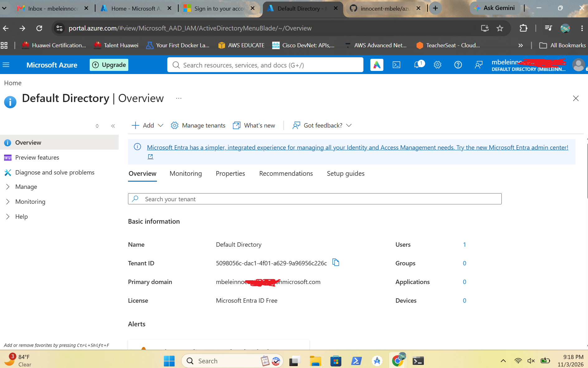
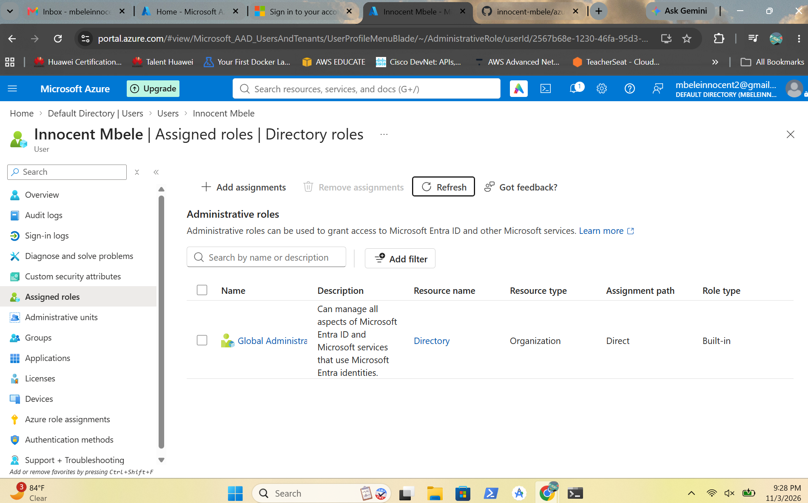
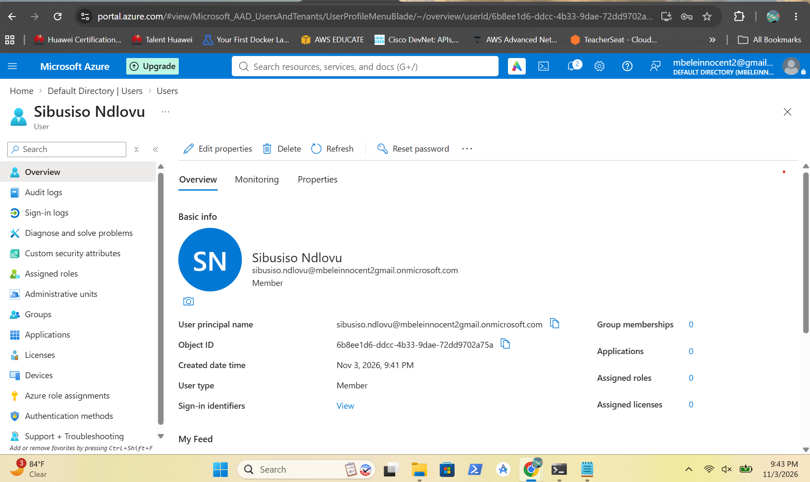
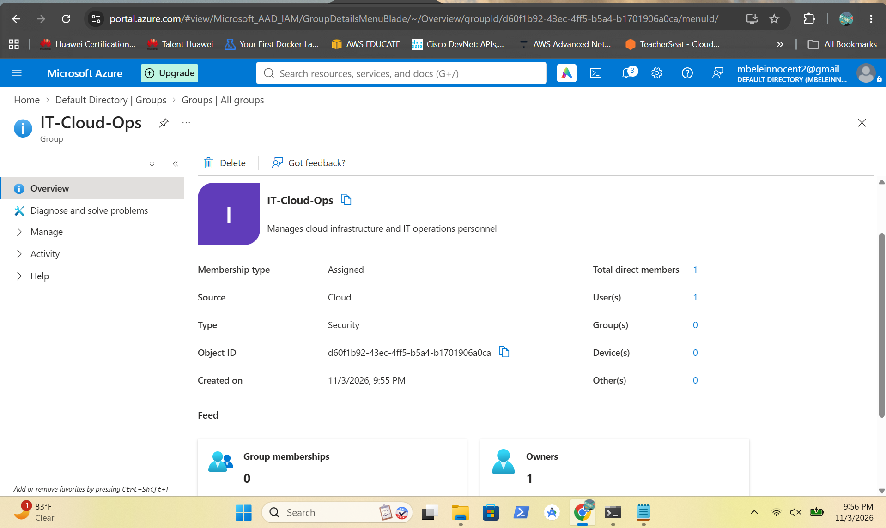
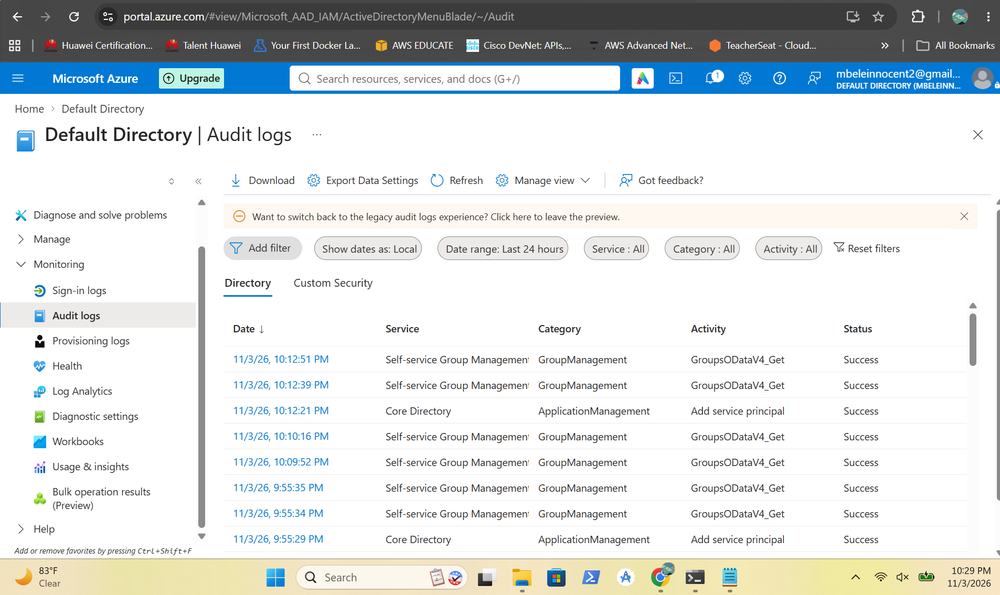
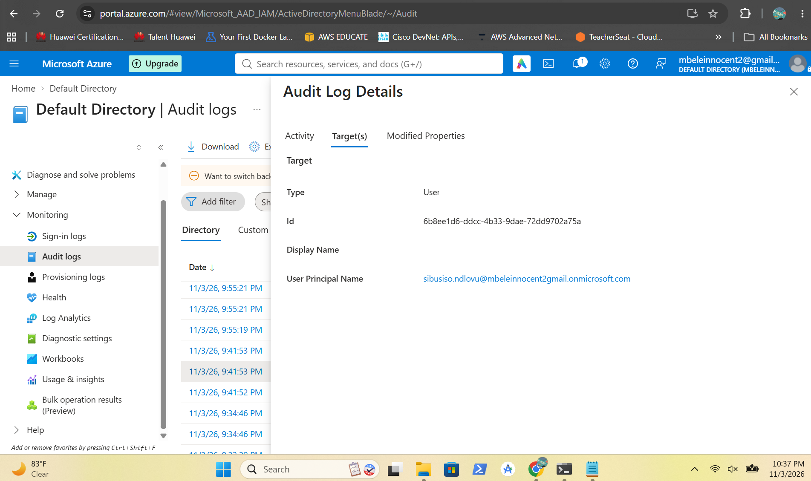
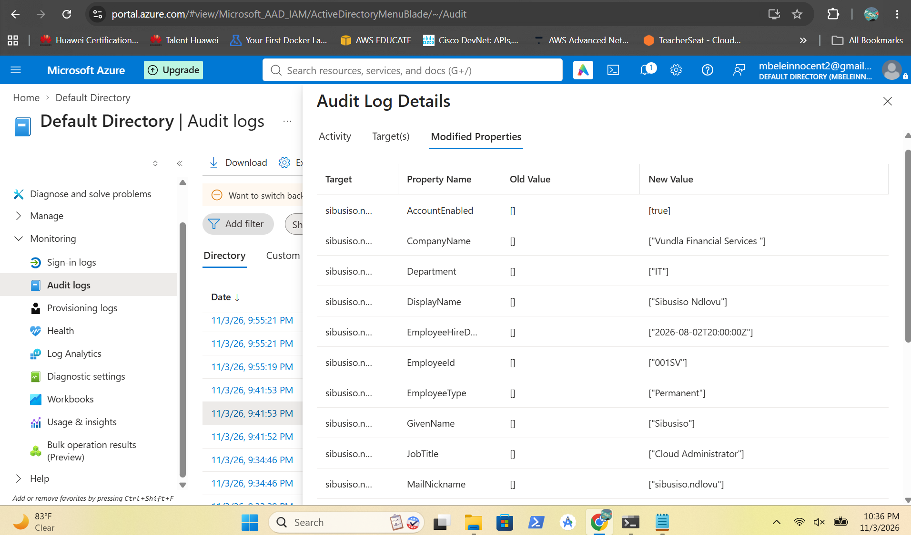
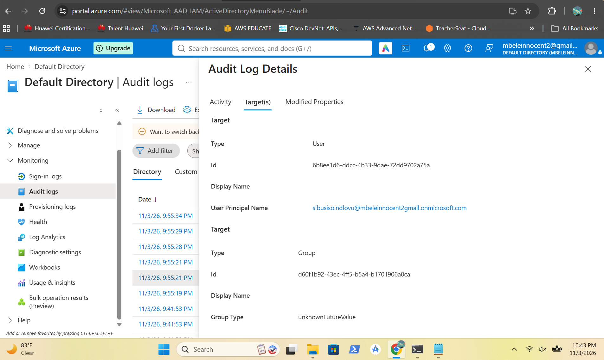
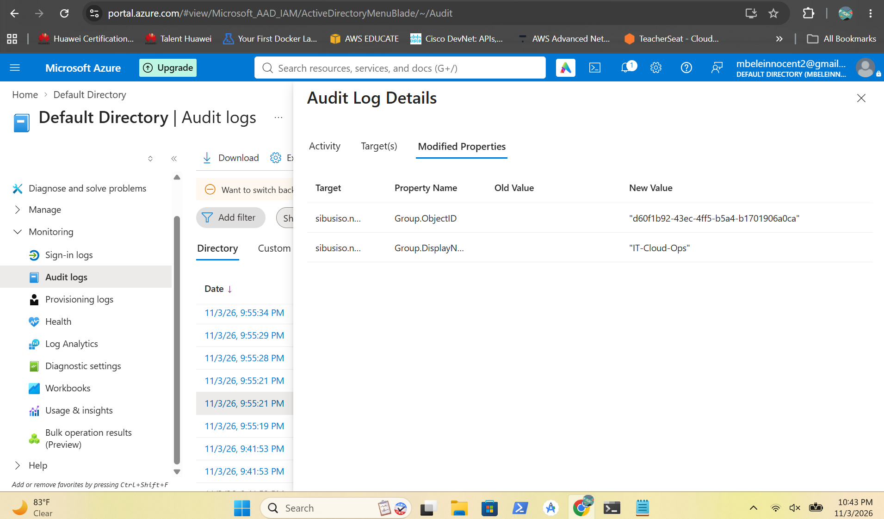
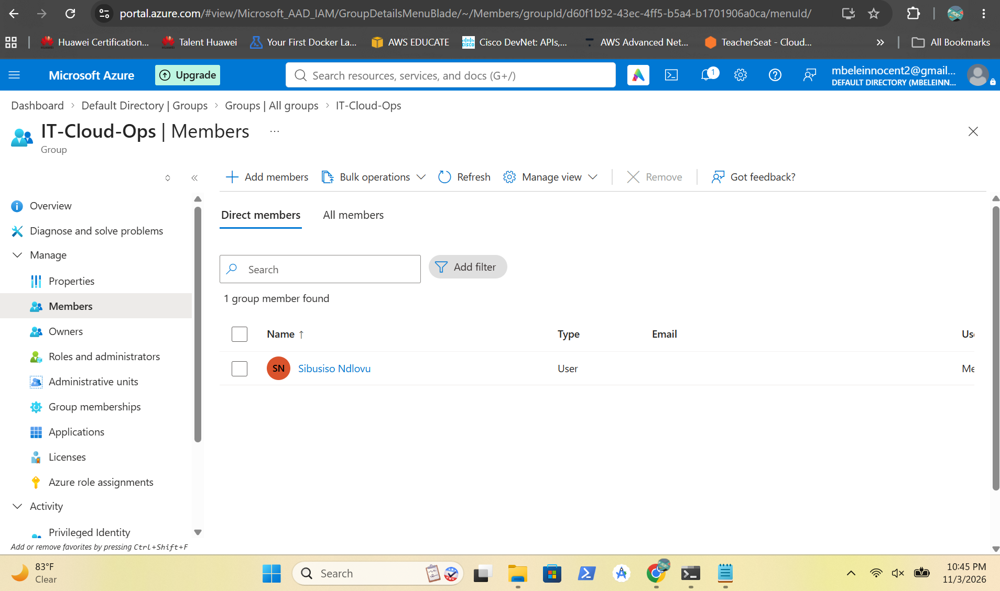

# Microsoft Entra ID Identity Management

## Overview

In this project i demonstrated Microsoft Entra ID identity and access administration within an Azure tenant. The implementation involved inspecting the tenant configuration, verifying the Global Administrator role, creating an internal user account, configuring user attributes and creating a security group with an assigned owner and member.

I also reviewed sign-in logs and directory audit logs to examine user provisioning and group membership activities. I inspected the audit records to verify the initiating administrator, affected directory objects, modified properties and operation status.

---

## Screenshots

### Default Tenant Overview

Shows the Default Directory tenant overview and its Microsoft Entra ID configuration.

---

### Global Administrator Role

Shows the Global Administrator directory role assigned to the administrator account.

---

### User Created

Shows the Sibusiso Ndlovu internal user account successfully created in Microsoft Entra ID.

---

### Security Group Created

Shows the IT-Cloud-Ops security group configured with assigned membership, an owner and a member.

---

### Directory Audit Logs

Shows the directory audit log entries generated during user provisioning and security group administration.

---

### User Creation Audit - Target Resources

Shows the user object identified as the target of the successful Add user audit operation.

---

### User Creation Audit - Modified Properties

Shows the user attributes recorded in the Modified Properties section of the Add user audit event.

---

### Group Membership Audit - Target Resources

Shows the user and security group identified as target resources in the Add member to group audit event.

---

### Group Membership Audit - Modified Properties

Shows the group object ID and display name recorded in the Modified Properties section of the group membership audit event.

---

### Group Membership Verified

Shows the IT-Cloud-Ops group membership view confirming that Sibusiso Ndlovu was successfully added as a member.

