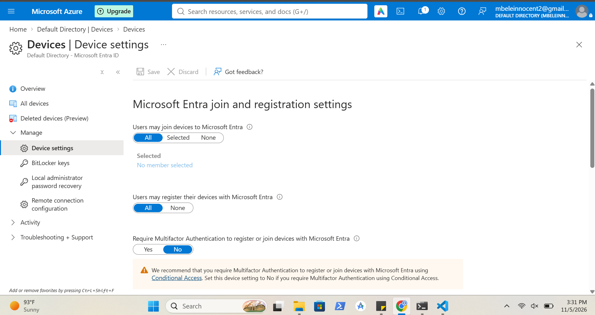
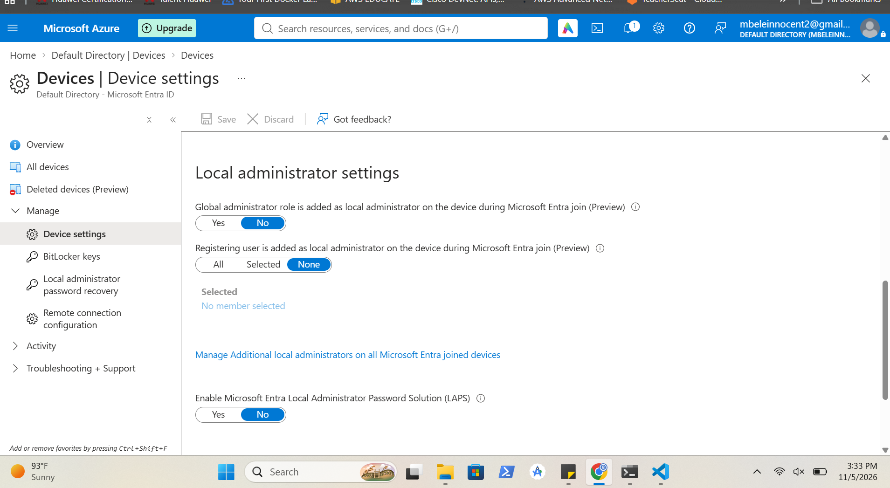
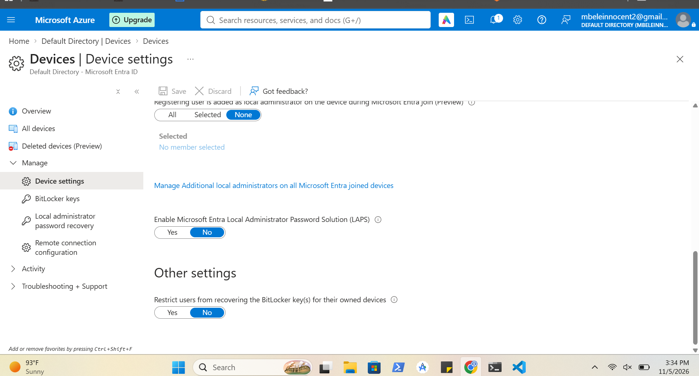
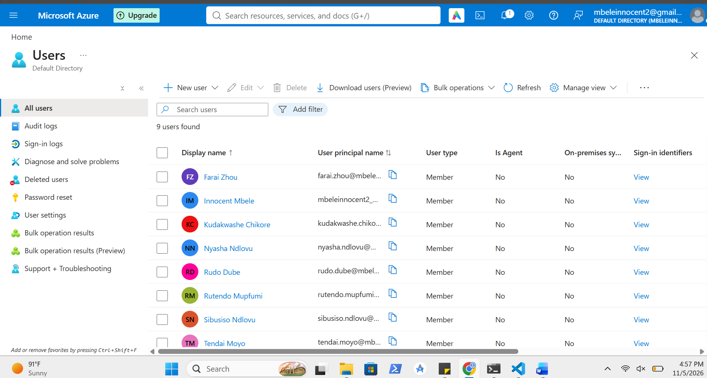
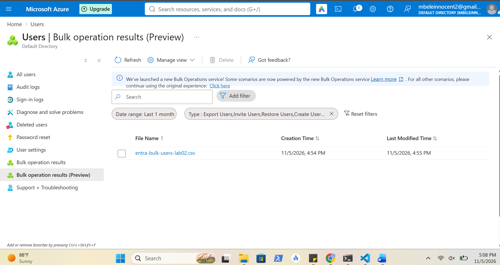
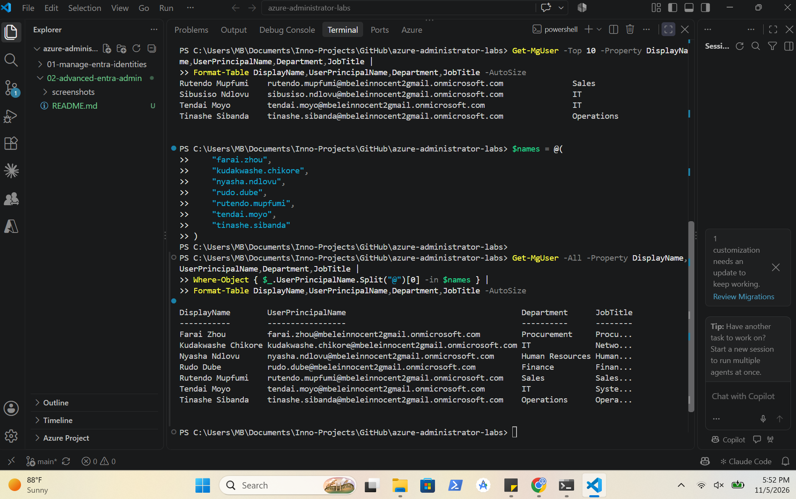
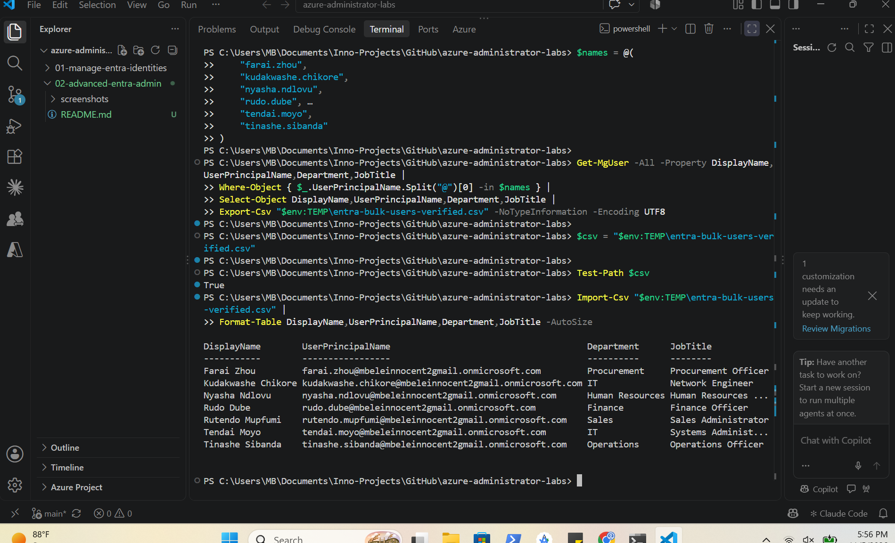
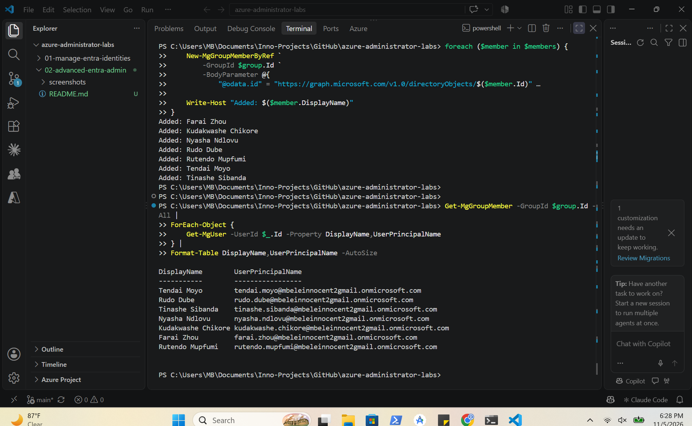

# Advanced Microsoft Entra ID Administration

## Overview

I explored advanced Microsoft Entra ID admin within an Azure tenant. This involved inspecting device join, registration and security settings, performing bulk user creation and managing security group membership. I created seven internal user accounts using the Microsoft Entra ID bulk user creation feature. Encountered a minor challenge when working with the CSV bulk operation as the portal did not provide clear confirmation of the operation results.

To fix this I then used Microsoft Graph PowerShell by following the guidance in Microsoft's documentation on Bulk operations service limitations from https://learn.microsoft.com/en-us/entra/fundamentals/bulk-operations-service-limitations?WT.mc_id=Portal-Microsoft_AAD_IAM. I then established a delegated Graph connection, retrieved and verified all the 7 user accounts and exported their profile information to CSV. I also created a separate security group and named it IT-Cloud-Ops-Automation using Microsoft Graph PowerShell and automated the addition of all 7 users. I independently retrieved the group membership to verify that all 7 accounts had been added successfully.

---

## Screenshots

### Device Join and Registration Settings

Shows the Microsoft Entra ID device join and registration configuration, including user permissions, MFA requirements and device limits.

---

### Local Administrator Settings

Shows the device local administrator settings configured within Microsoft Entra ID.

---

### Device Security Settings

Shows the Microsoft Entra LAPS and BitLocker recovery key security settings.

---

### Bulk User Creation

Shows the seven internal user accounts created through the Microsoft Entra ID bulk user creation process.

---

### Bulk Operation Preview

Shows the uploaded CSV file recorded in the Microsoft Entra ID bulk operation preview.

---

### Microsoft Graph User Verification

Shows the seven bulk-created user accounts retrieved and verified using Microsoft Graph PowerShell, including their UPNs, departments and job titles.

---

### CSV Export Verification

Shows the exported user information imported back into PowerShell, confirming the seven user records and their profile attributes.

---

### Automated Group Membership Verification

Shows the seven users successfully added to the IT-Cloud-Ops-Automation security group using Microsoft Graph PowerShell and independently retrieved to verify group membership.

