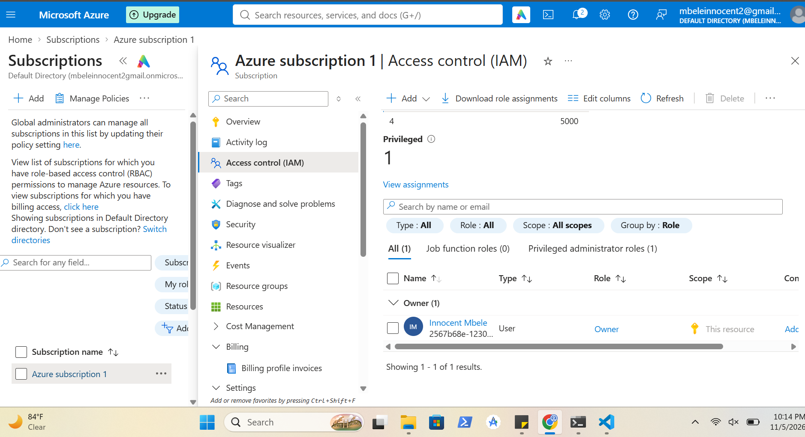
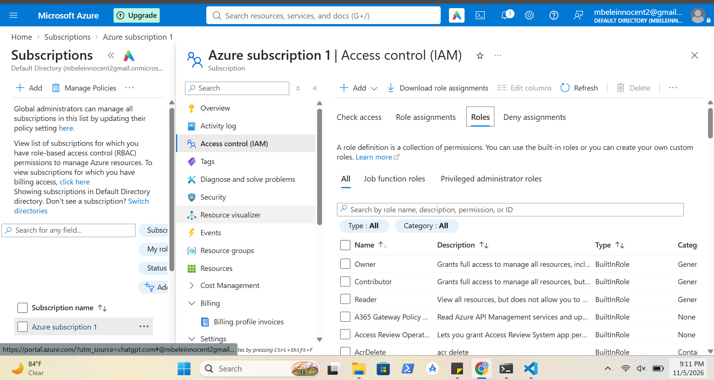
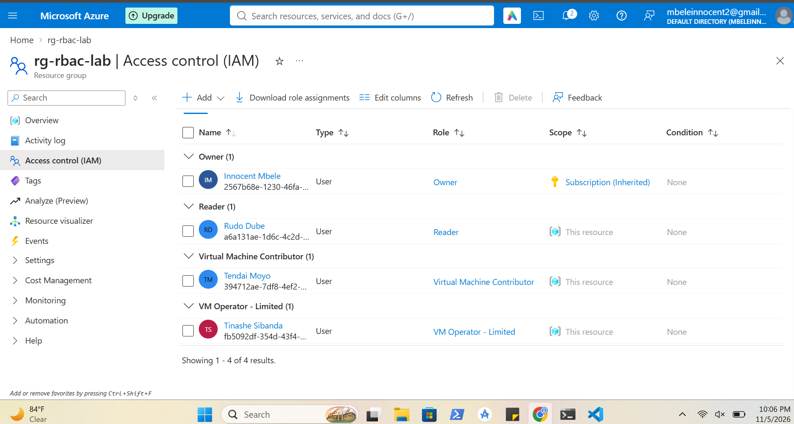
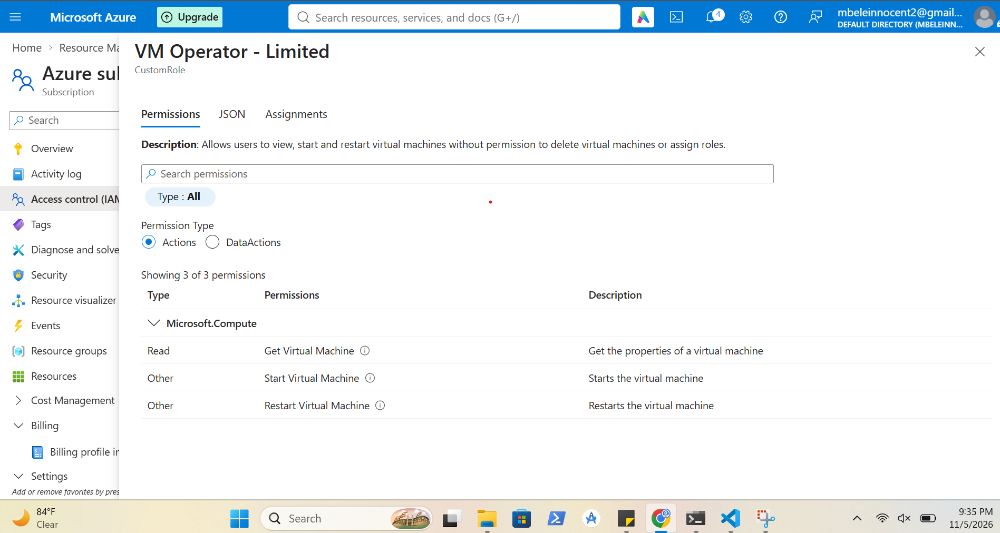

# Azure Role-Based Access Control (RBAC)

## Overview

I demonstrated Azure Role-Based Access Control (RBAC) by reviewing role definitions, examining subscription-level permissions, creating a resource group and configuring role assignments at resource group scope. I assigned built-in roles to different user accounts, including Reader and Virtual Machine Contributor. I also created a custom role named **VM Operator - Limited**, granting permission to view, start and restart virtual machines without permission to delete virtual machines or assign roles and assigned it Tinashe Sibanda and verified the role assignment under the `rg-rbac-lab` resource group.

---

## Screenshots

### Subscription Role Assignments

Shows the Owner role assignment inherited at subscription scope.

### Built-in Role Permissions

Shows the permissions associated with the built-in Azure RBAC roles.

### Resource Group Role Assignments

Shows the built-in and custom Azure RBAC roles created and assigned to the respective user accounts at the `rg-rbac-lab` resource-group scope, including Reader, Virtual Machine Contributor and VM Operator - Limited.

### Custom Role Creation

Shows the creation of the VM Operator - Limited custom role with permissions to read, start and restart virtual machines.

### Custom Role Assignment

Shows the VM Operator - Limited role assigned to Tinashe Sibanda at the resource-group scope.

