# Azure Subscription Governance

## Overview

I reviewed the Azure subscription, examined subscription and resource group configurations and implemented Azure Policy to enforce resource tagging requirements. Then created a policy assignment named **Require a tag on resources** at the `rg-rbac-lab` resource group scope requiring resources to have the `Environment=Lab` tag. I then deployed and configured an Ubuntu virtual machine and its supporting infrastructure including a network interface, network security group, virtual network and managed OS disk. Verified the policy compliance results using the Azure Portal, Azure CLI and PowerShell confirming that all five infrastructure resources were compliant.

Also implemented automated virtual machine shutdown using Azure Automation and created an Automation Account named `aa-rbaclab-shutdown`, configured its system-assigned managed identity and assigned the **Virtual Machine Contributor** role at the target virtual machine scope. I published a PowerShell runbook named **Shutdown-VM-Daily-UAE** and configured three daily schedules at 2:00 AM, 5:00 PM and 10:00 PM using the `Asia/Dubai` time zone. 

---

## Screenshots

### Subscription Login and Overview

Shows the Azure CLI login, active account and subscription information.

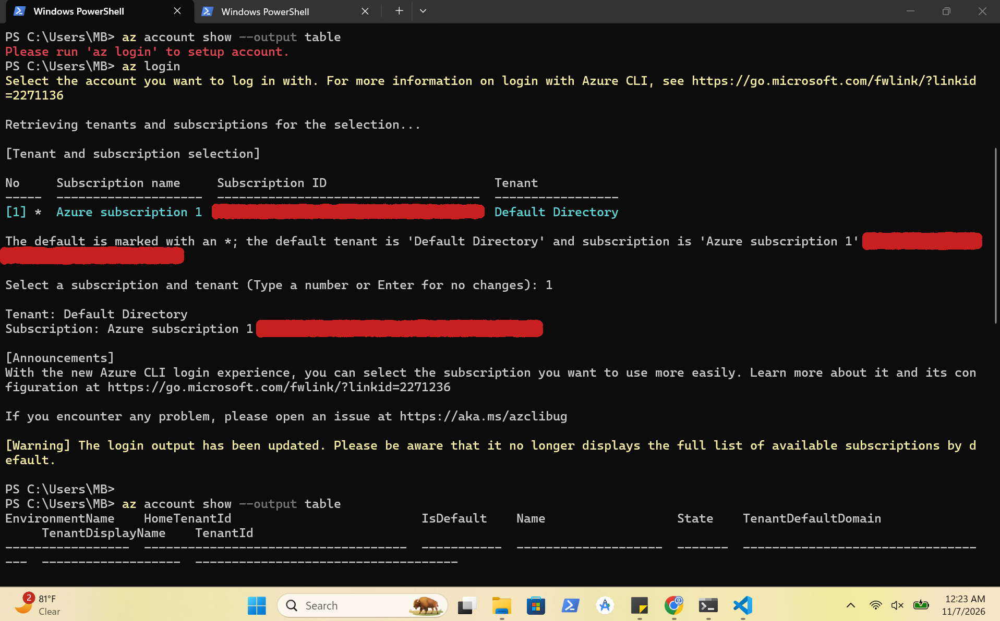

### Subscription JSON and CLI Queries

Shows subscription information retrieved in JSON format and Azure CLI queries used to inspect subscription details.

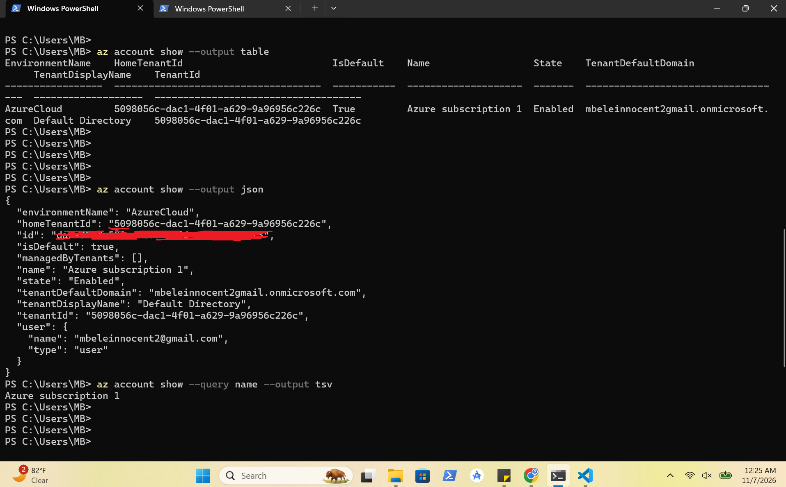

### Subscription and Resource Group Governance

Shows the subscription and resource group governance configuration.

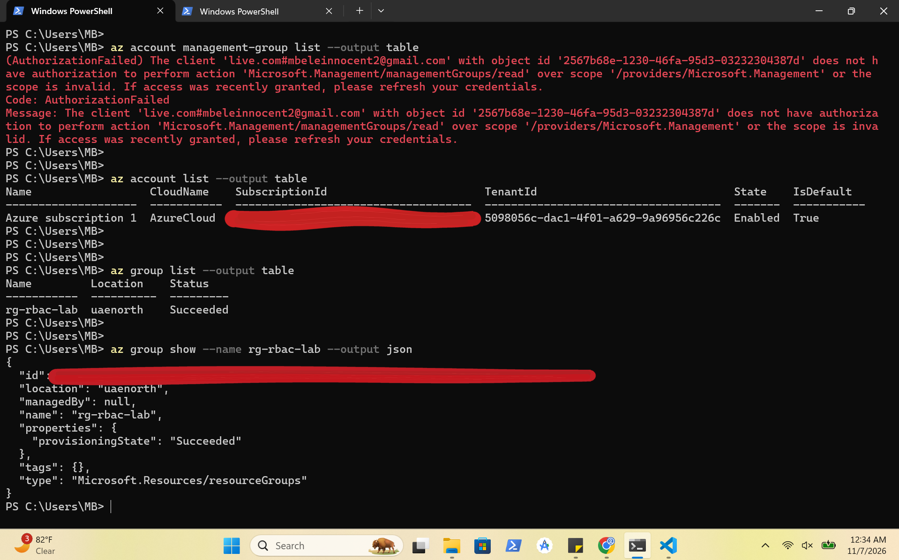

### VM Deployment Success

Shows the successful deployment of the virtual machine and its supporting Azure infrastructure.

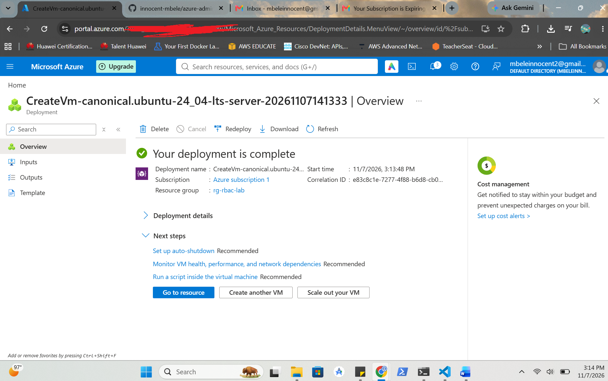

### VM Running Overview

Shows the deployed virtual machine and its configuration in the Azure Portal.

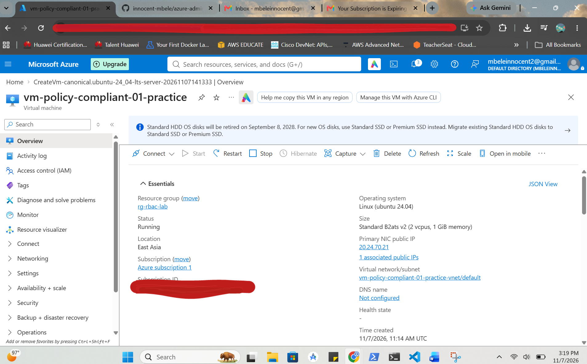

### Azure Policy Compliance Dashboard

Shows the Azure Policy compliance dashboard and the compliance overview for the resource group.

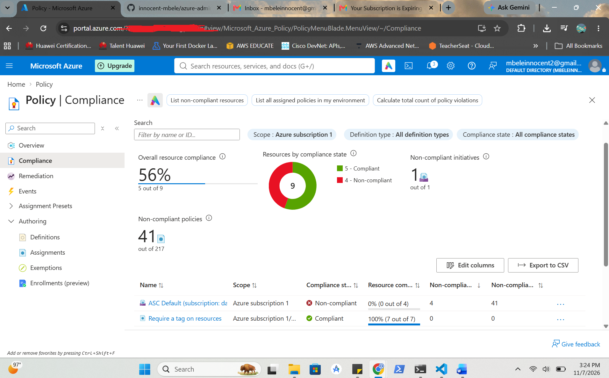

### Require a Tag Policy

Shows the configured Require a tag on resources policy assignment and its compliance information.

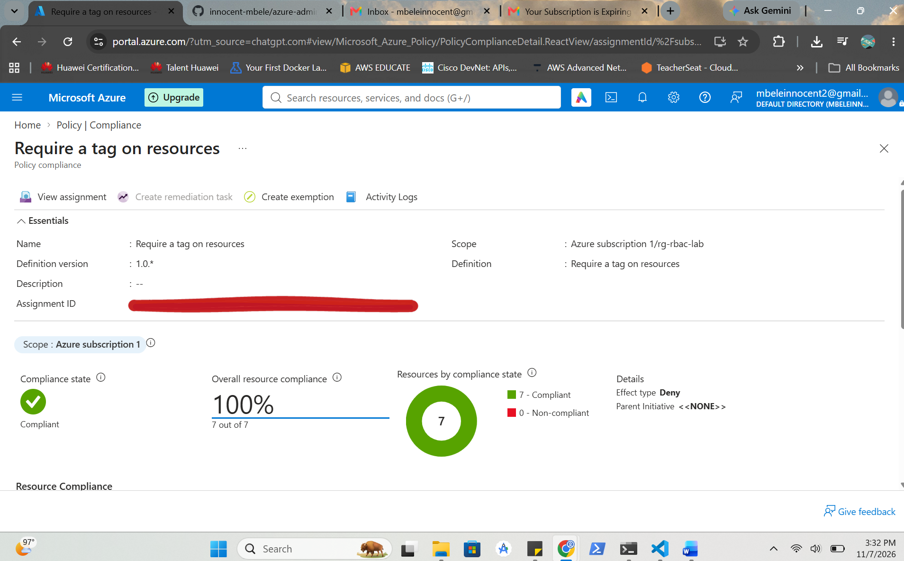

### Individual Resource Compliance

Shows the individual resources evaluated against the Require a tag on resources policy, including their compliance results.

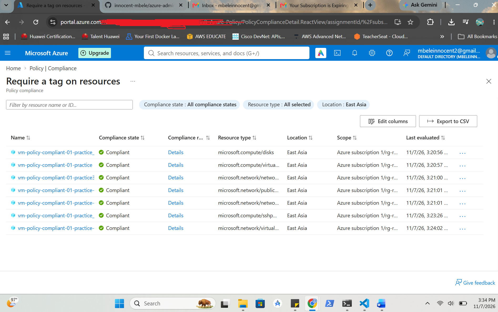

### PowerShell Policy Compliance Verification

Shows the use of PowerShell to retrieve and inspect Azure Policy compliance results.

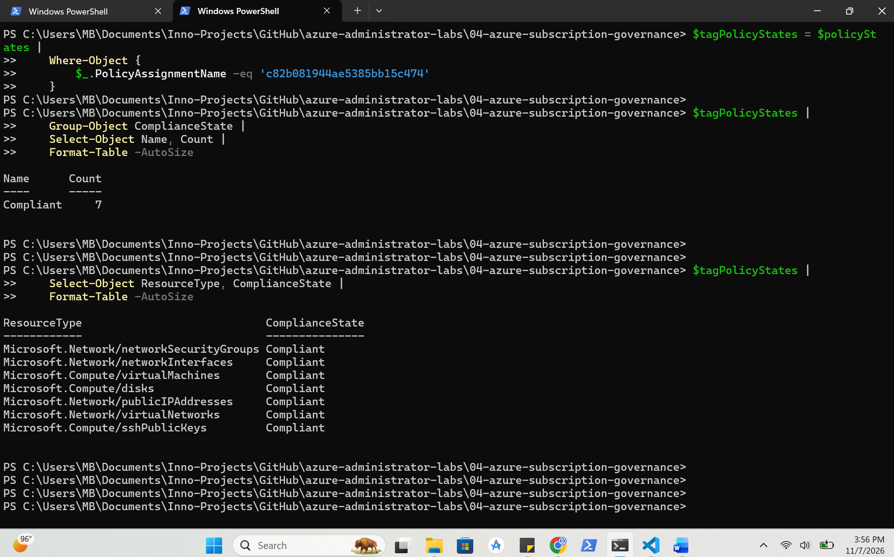

### Automated VM Shutdown Schedules

Shows the three enabled daily shutdown schedules associated with the `Shutdown-VM-Daily-UAE` runbook, configured for 2:00 AM, 5:00 PM and 10:00 PM using Gulf Standard Time (UAE time).

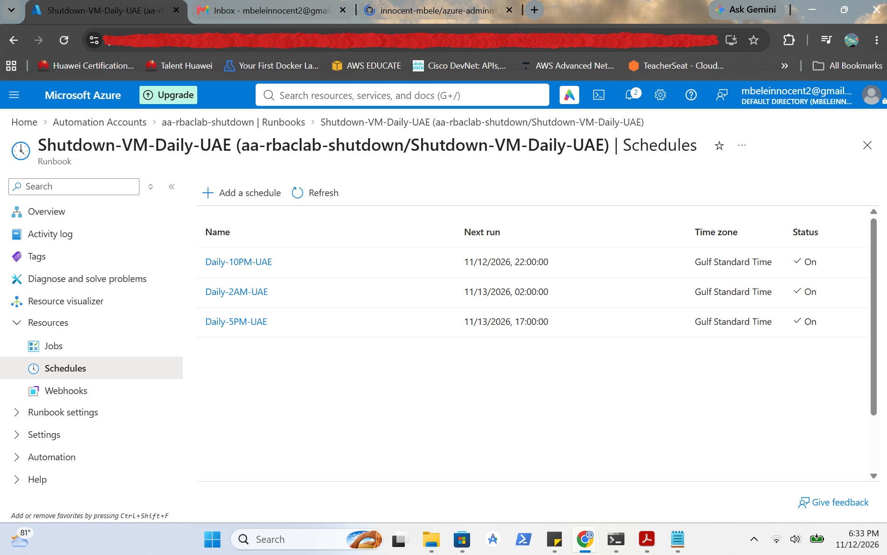

### Automated VM Shutdown Verification

Shows the successful execution of the `Shutdown-VM-Daily-UAE` runbook, including the completed Azure Automation job and its execution details. The VM's final `PowerState/deallocated` state was independently verified using PowerShell.

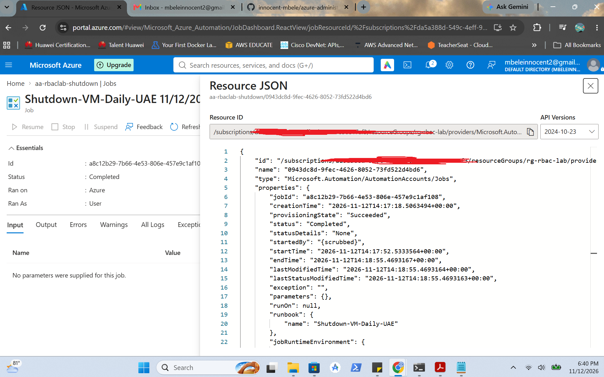