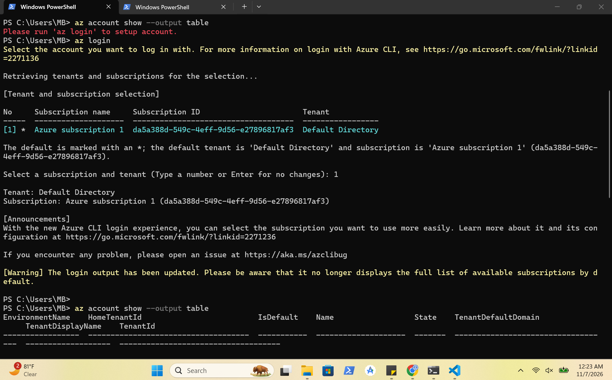
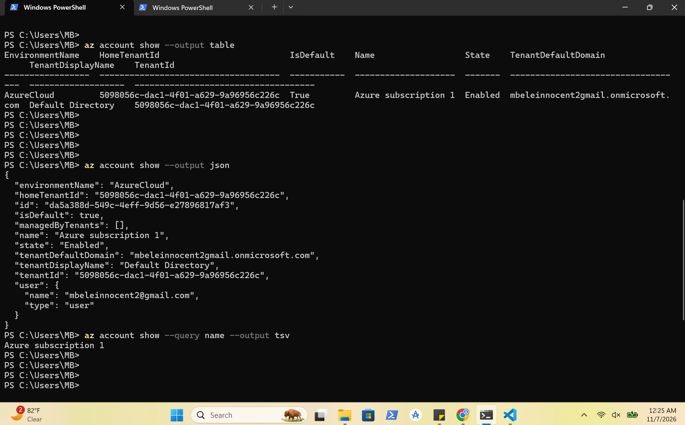
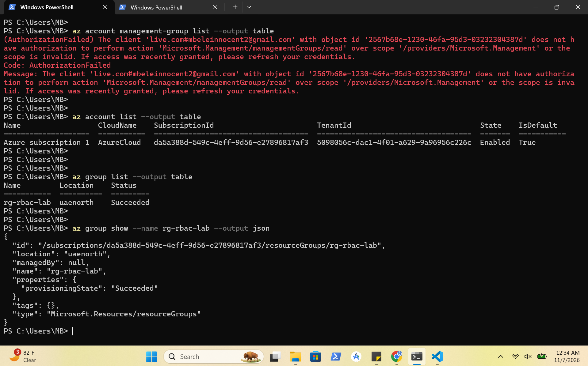
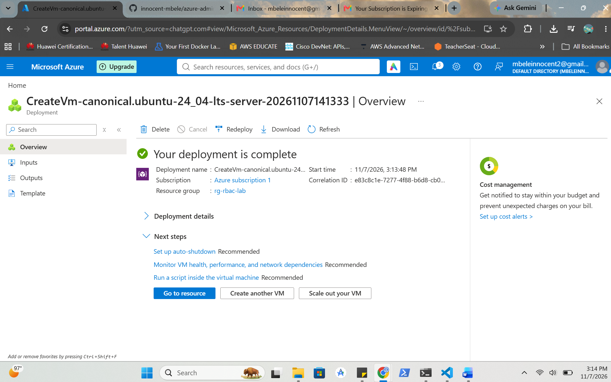
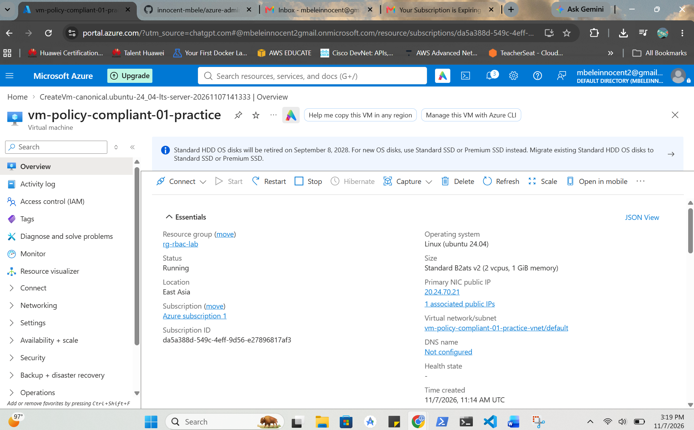
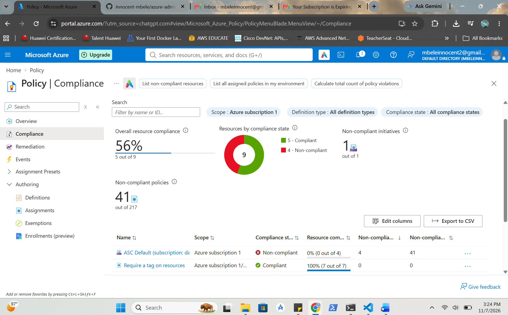
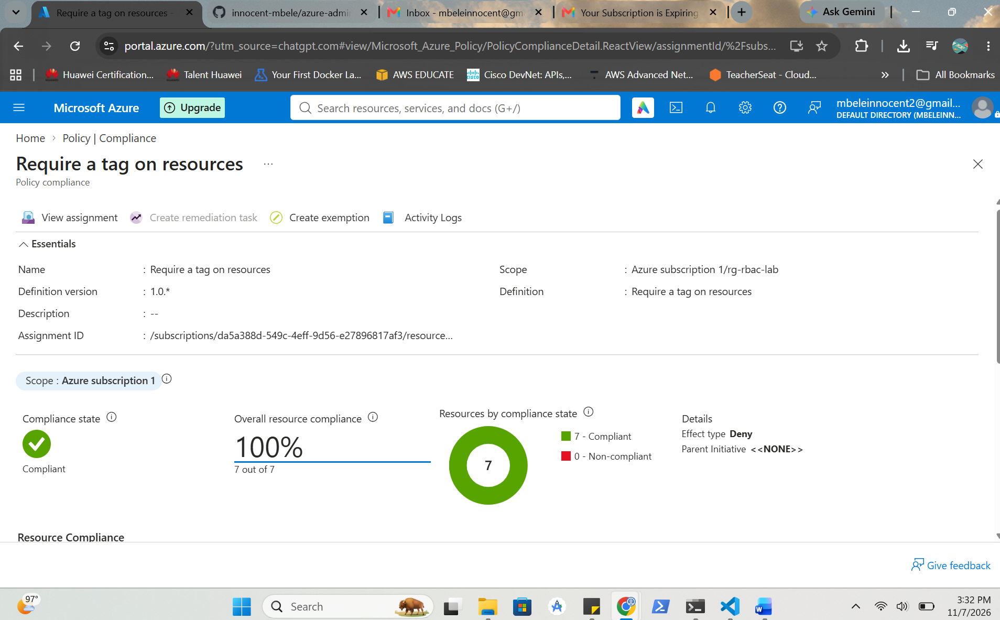
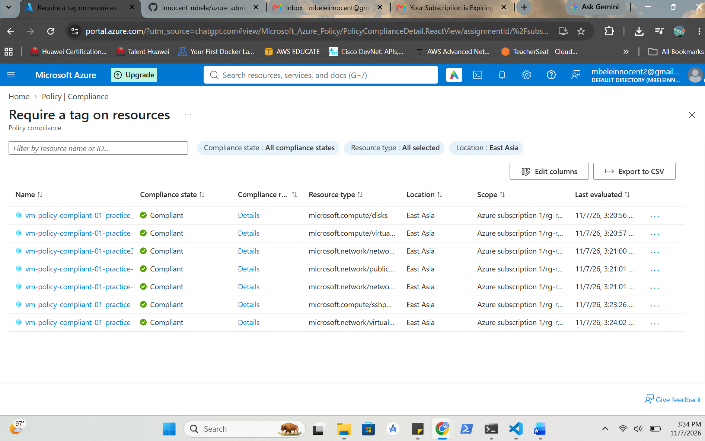
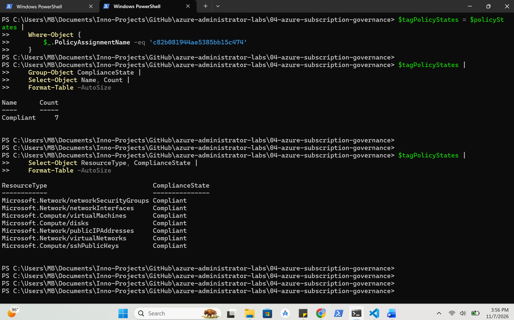

# Azure Subscription Governance

## Overview

I demonstrated Azure subscription governance by inspecting subscription and resource-group details, assigning the built-in **Require a tag on resources** Azure Policy and verifying compliance.

I assigned the policy to `rg-rbac-lab` with the required tag `Environment = Lab` and the **Deny** effect. I deployed an Ubuntu virtual machine and applied the tag to its associated resources. I confimed all seven evaluated resources were compliant using Azure Portal and PowerShell. 

---

## Screenshots

### Subscription Overview

Shows Azure CLI login and the active subscription.

### Subscription Queries

Shows subscription details in JSON format and a JMESPath query.

### Resource Group Governance

Shows subscription and resource-group inspection, including the management-group permission limitation.

### VM Deployment

Shows the successful deployment of the Ubuntu virtual machine.

### VM Running

Shows the deployed VM in the Running state.

### Azure Policy Compliance Dashboard

Shows overall subscription compliance and the separate ASC Default initiative findings.

### Tag Policy Compliance

Shows the **Require a tag on resources** policy at 100% compliance (7 of 7 resources).

### Resource Compliance

Shows the seven individual resources marked Compliant.

### PowerShell Verification

Shows PowerShell confirming seven compliant resources and zero non-compliant resources for the tag policy assignment.

