# Implement and Manage Virtual Networking

## Overview

I created an additional subnet and a separate branch virtual network. Then i configured bidirectional VNet peering, network security groups, static private and public IP addresses, route tables and user defined routes. I also configured a Microsoft.Storage service endpoint and created a private DNS zone with a virtual network link.

At the end i deployed a Standard Azure Load Balancer with a frontend IP configuration, backend pool, TCP health probe and HTTP load-balancing rule. also enabled Azure Network Watcher in East Asia. Verified the deployed configurations using the Azure Portal, Azure CLI and PowerShell.

---

## Screenshots

### Additional Subnet Configuration

Shows the creation of an additional subnet in the existing virtual network.

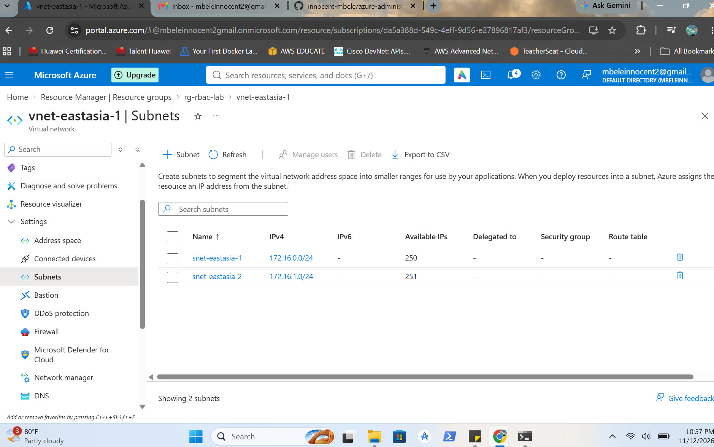

### Subnet CLI and PowerShell Verification

Shows the subnet address ranges retrieved and verified using Azure CLI and PowerShell.

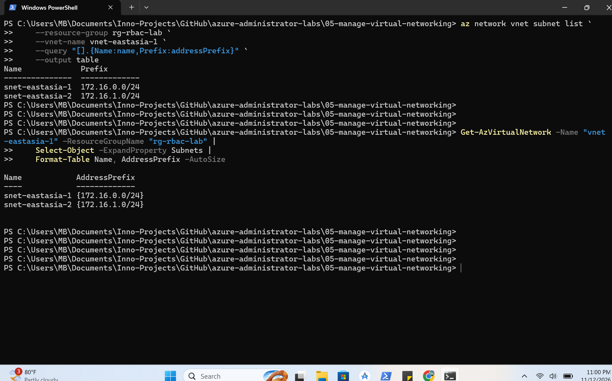

### Branch Network Deployment

Shows the deployment of the branch virtual network and its subnet.

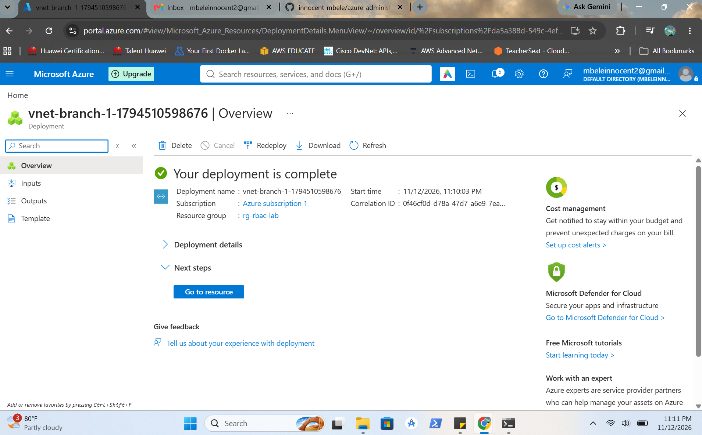

### Bidirectional VNet Peering

Shows the peering configuration connecting the main virtual network and the branch virtual network.

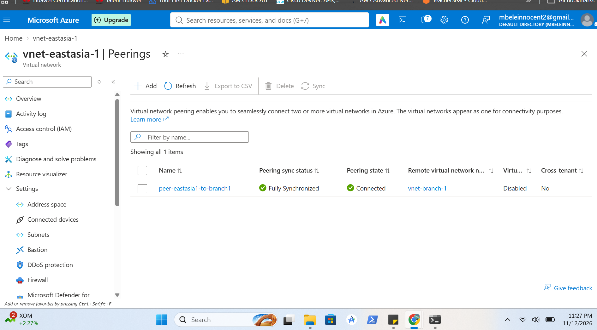

### Network Security Group Rules

Shows the custom inbound security rules configured on `nsg-branch-1`, including the RDP deny and HTTPS allow rules.

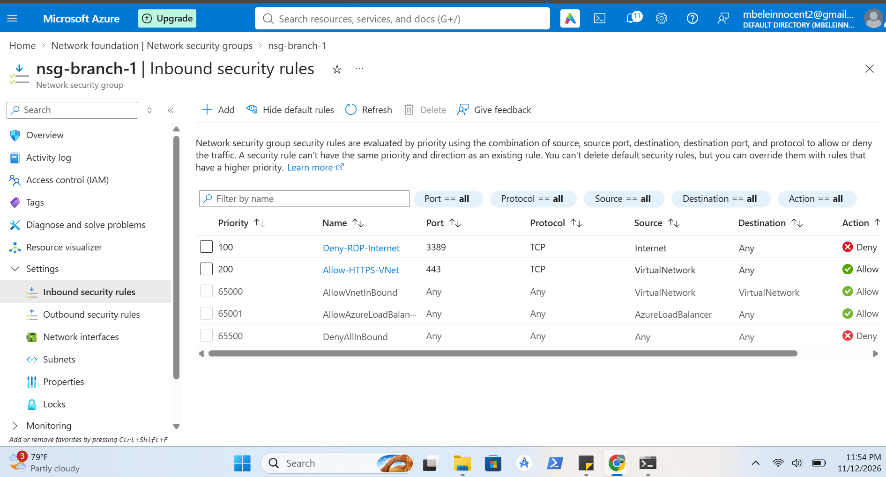

### Static Private IP Configuration

Shows the static private IP address `10.20.1.10` assigned to the branch network interface.

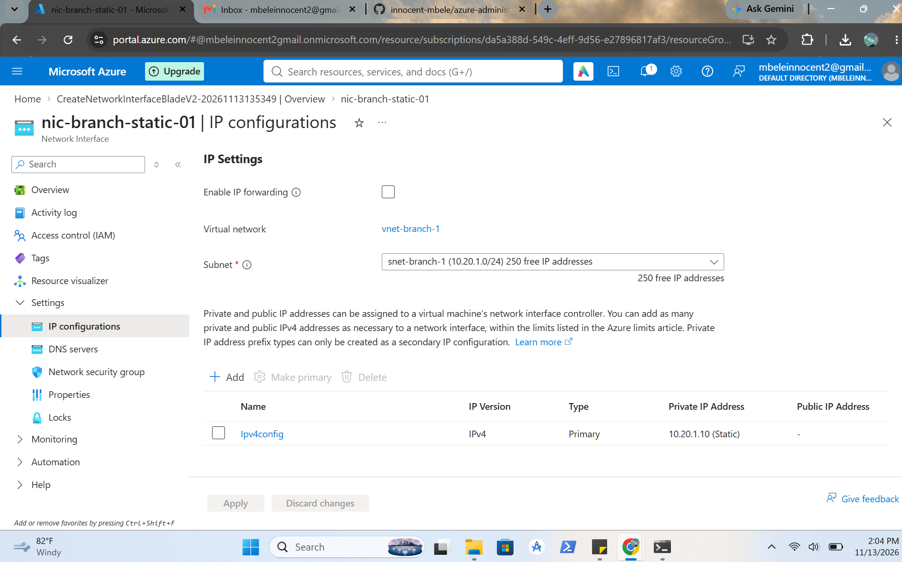

### Public IP Configuration

Shows the Standard public IP address created for the branch networking environment.

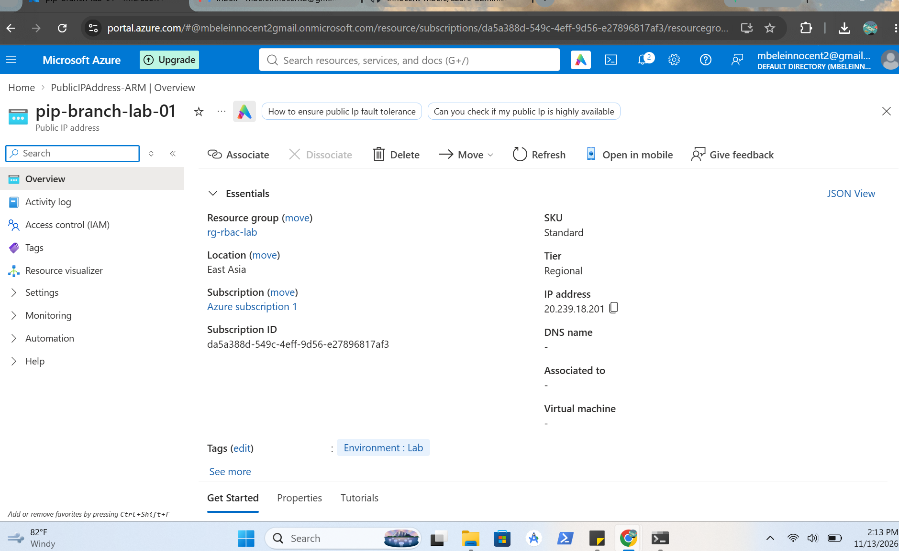

### Private IP CLI and PowerShell Verification

Shows the network interface configuration and verification of its static private IP address using Azure CLI and PowerShell.

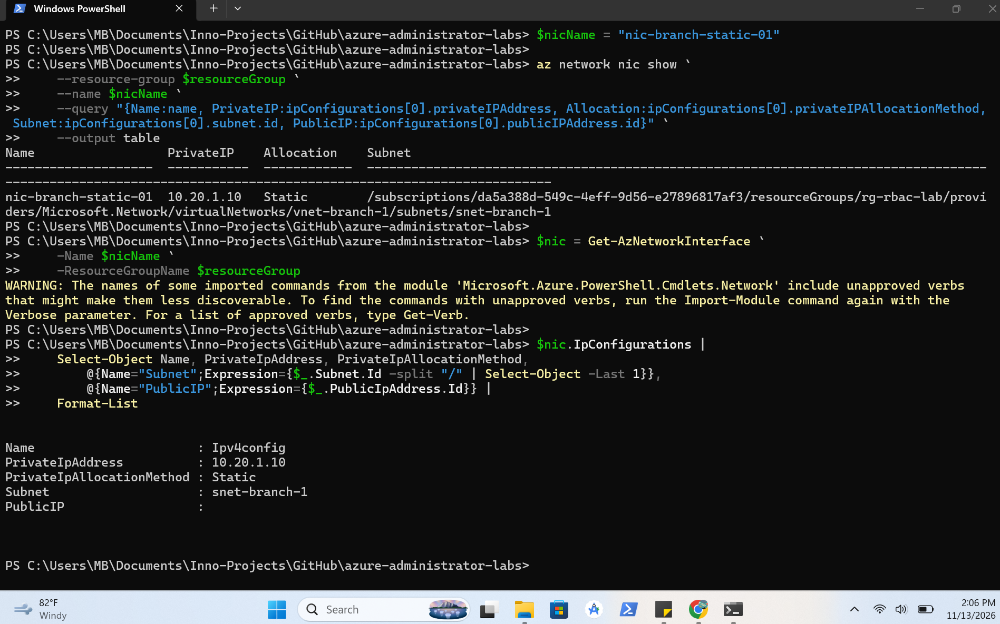

### User-Defined Route Configuration

Shows the custom route configured to block traffic destined for `192.0.2.0/24`.

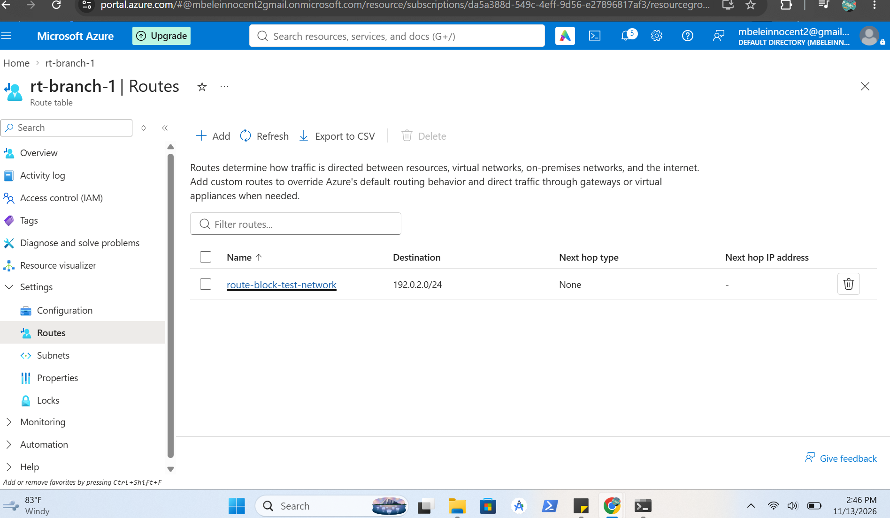

### Route Table Deployment

Shows the deployed route table `rt-branch-1` and its configuration.

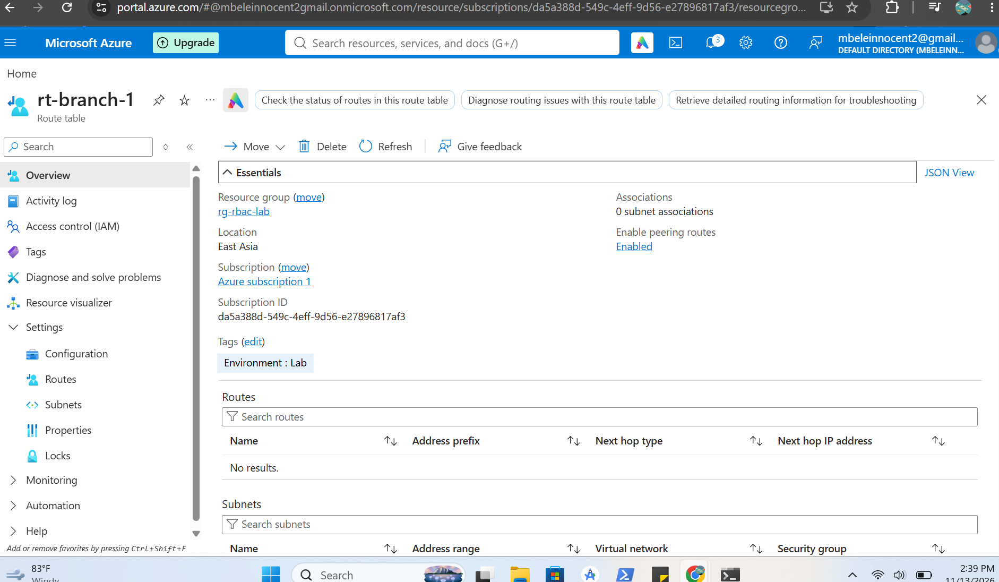

### Route Table Subnet Association

Shows the association of the route table with `snet-branch-1`.

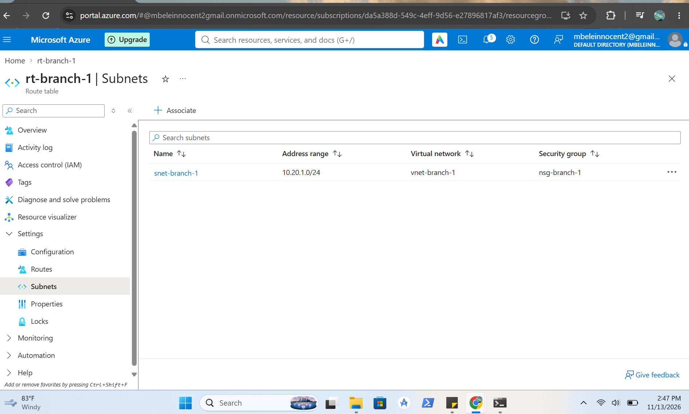

### Storage Service Endpoint Configuration

Shows the Microsoft.Storage service endpoint selected for the branch subnet.

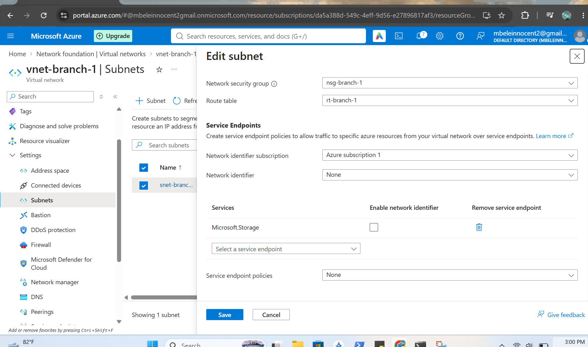

### Private DNS Zone and VNet Link

Shows the private DNS zone `lab.inno.internal` and its virtual network link.

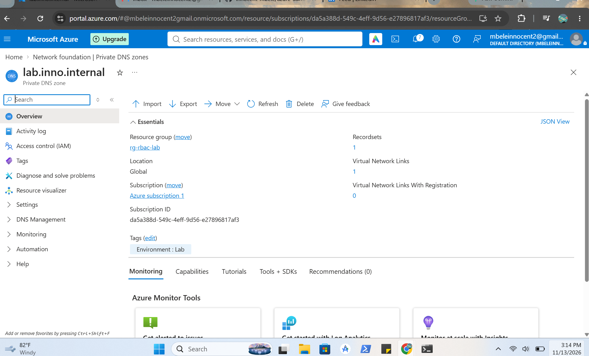

### Azure Load Balancer Configuration

Shows the deployed Standard Load Balancer `lb-branch-1`, its frontend public IP, backend pool and configured health probe and load-balancing rule.

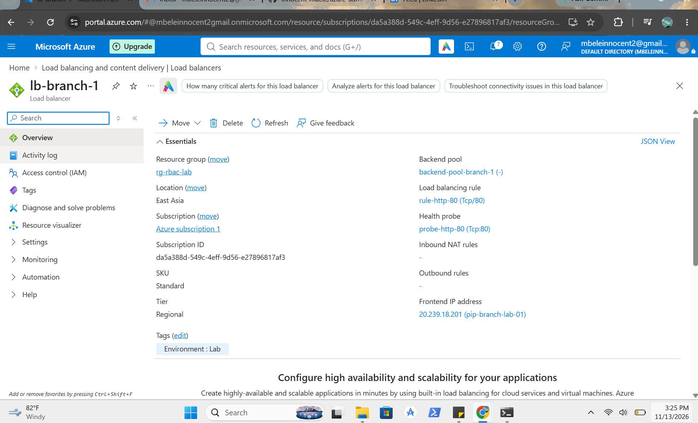

### Load Balancer Health Probe and Rule

Shows the TCP health probe and HTTP port 80 load-balancing rule configured on the Load Balancer.

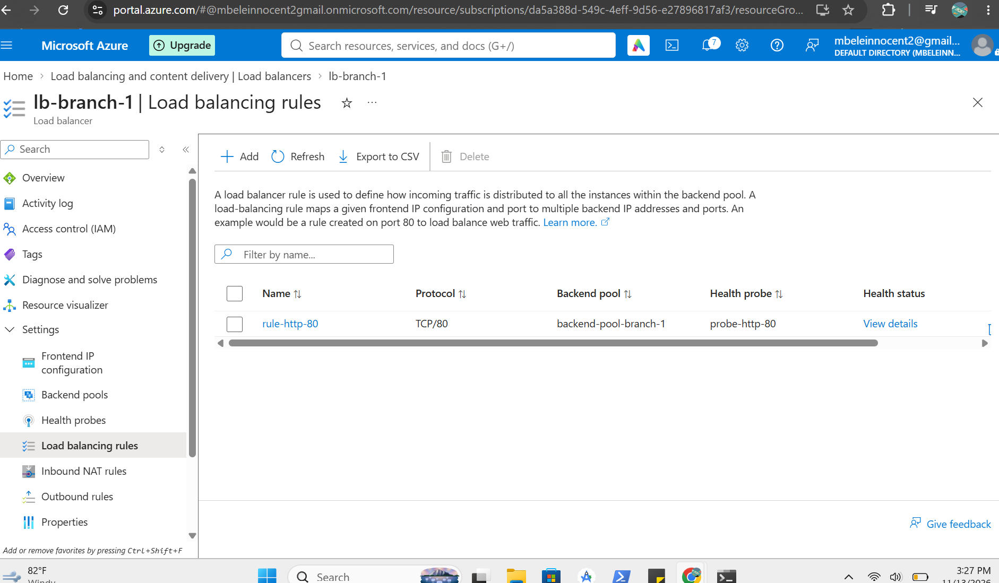

### Azure Network Watcher

Shows the enabled Network Watcher resource in the East Asia region.

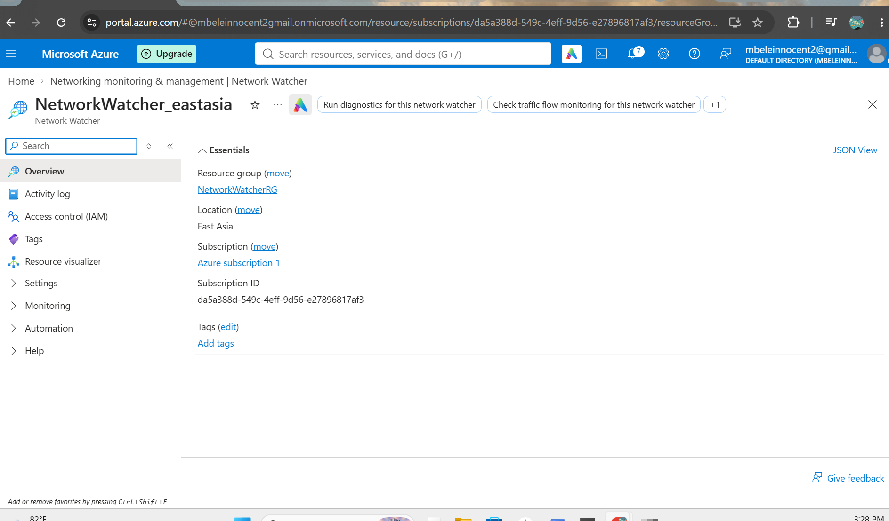