# Enterprise Compute and Application Infrastructure

Deployed an Ubuntu Server 24.04 virtual machine to host an internal enterprise application environment in Azure. Configured the app subnet and network security rules, established outbound connectivity using an Azure NAT Gateway and enabled secure graphical access through Azure Bastion. I then installed Docker Engine and Docker Compose to run the application infrastructure in containers. I deployed PostgreSQL 16 as the database service and created a dedicated database and application account for the Enterprise Management Portal. I built and deployed  Enterprise Management Portal using Gunicorn as the application server. 

---

## Screenshots

### Application Subnet and Network Security Group

Shows the application subnet and its associated network security group configuration.

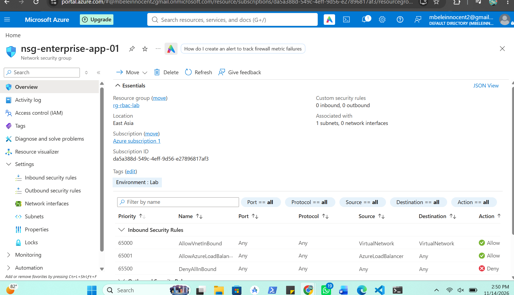

### Initial Application NSG Inbound Rules

Shows the initial custom inbound security rules configured for the enterprise application environment.

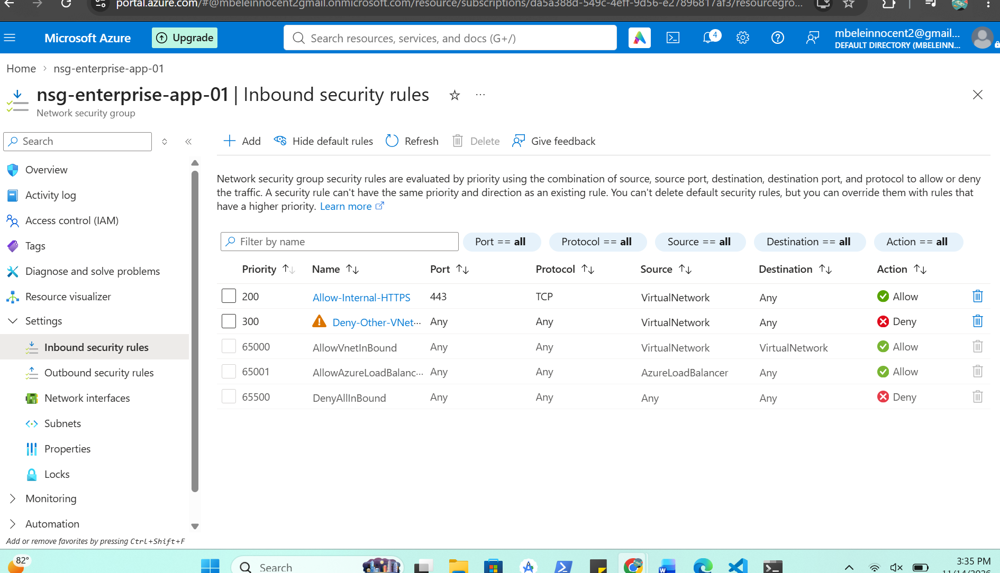

### Enterprise Application Virtual Machine

Shows the deployed enterprise application virtual machine and its Azure configuration.

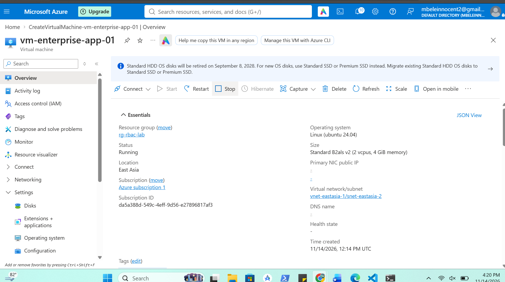

### Ubuntu System Verification

Shows the Ubuntu Server environment and the verification of its operating system and system configuration.

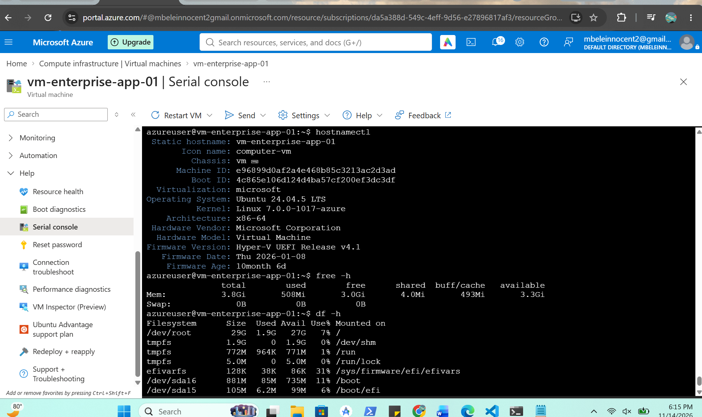

### NAT Gateway Public IP

Shows the Standard static public IP address allocated for the application's outbound connectivity through the NAT Gateway.

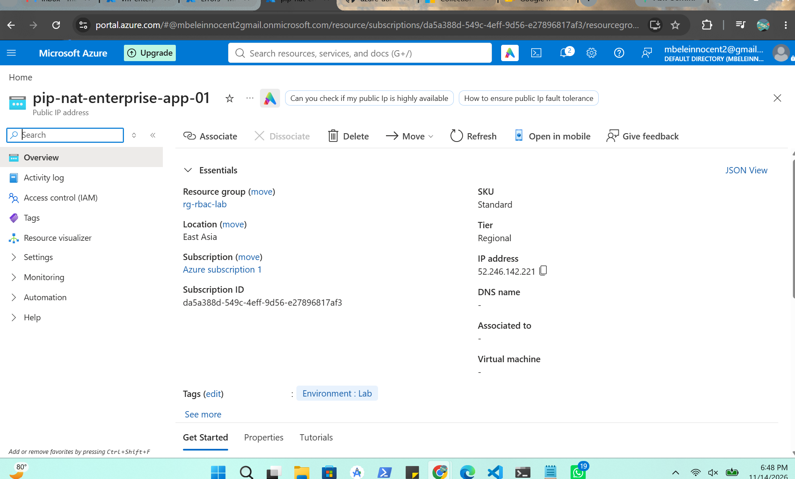

### Ubuntu Graphical Desktop Through Azure Bastion

Shows the Ubuntu graphical desktop accessed securely through Azure Bastion without assigning a public IP address to the virtual machine.

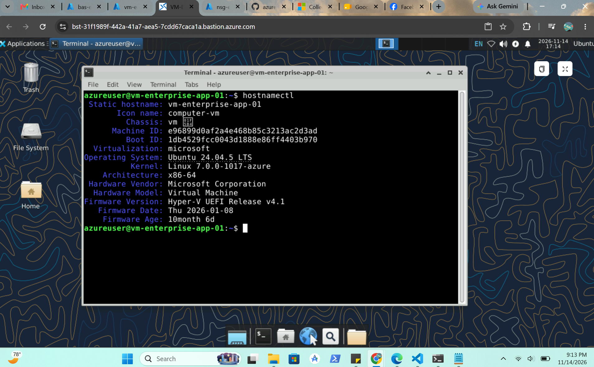

### NAT Gateway Deployment

Shows the deployed NAT Gateway and its configuration for the enterprise application subnet.

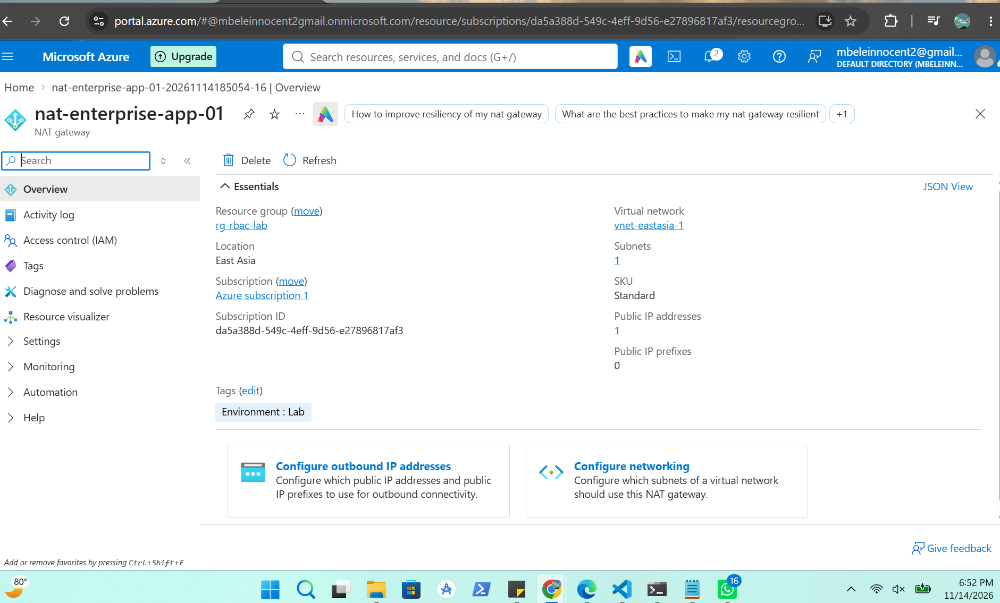

### Virtual Machine Disk Configuration

Shows the operating system disk configuration, including its storage type and capacity.

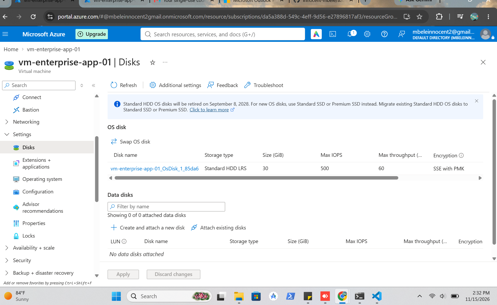

### PostgreSQL Container Deployment

Shows the deployment of PostgreSQL 16 using Docker Compose as the database service for the enterprise application environment.

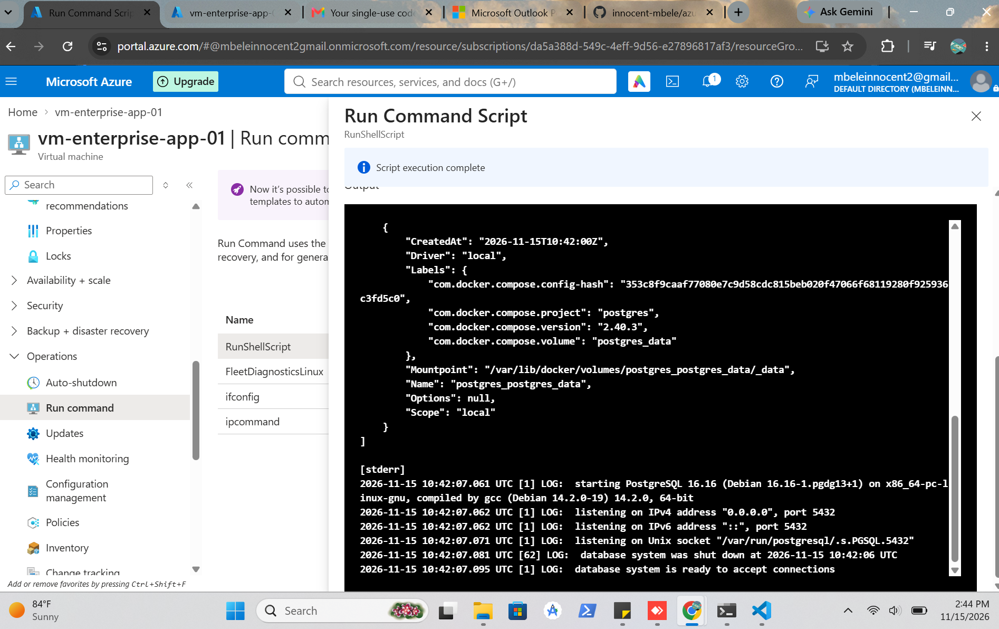

### Enterprise Portal Database

Shows the creation and verification of the dedicated `enterprise_portal` database and its application database account.

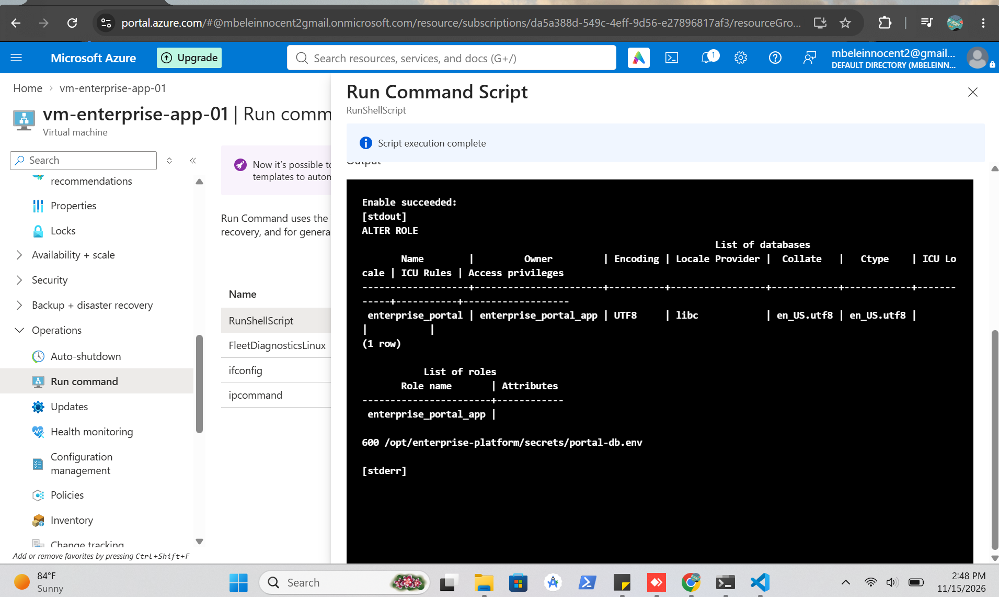

### Enterprise Portal Deployment and Verification

Shows the deployed Flask application and the verification of its health endpoint, PostgreSQL connectivity and Gunicorn application server.

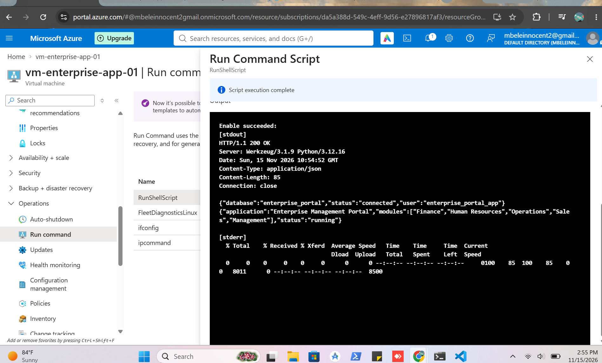

### Enterprise Management Portal Dashboard

Shows the Enterprise Management Portal dashboard running in Firefox inside the Ubuntu virtual machine. The application is accessed locally through `127.0.0.1:8080`.

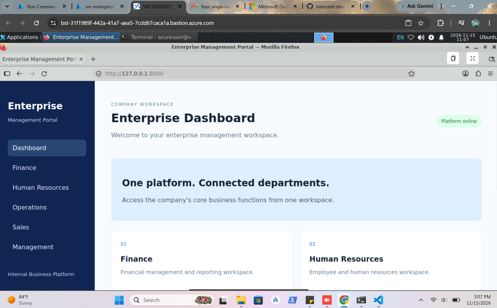

### Final Enterprise Application NSG Inbound Rules

Shows the custom and default inbound security rules configured on `nsg-enterprise-app-01`, including SSH access, internal HTTPS, Azure Bastion RDP access and the additional inbound traffic restriction.

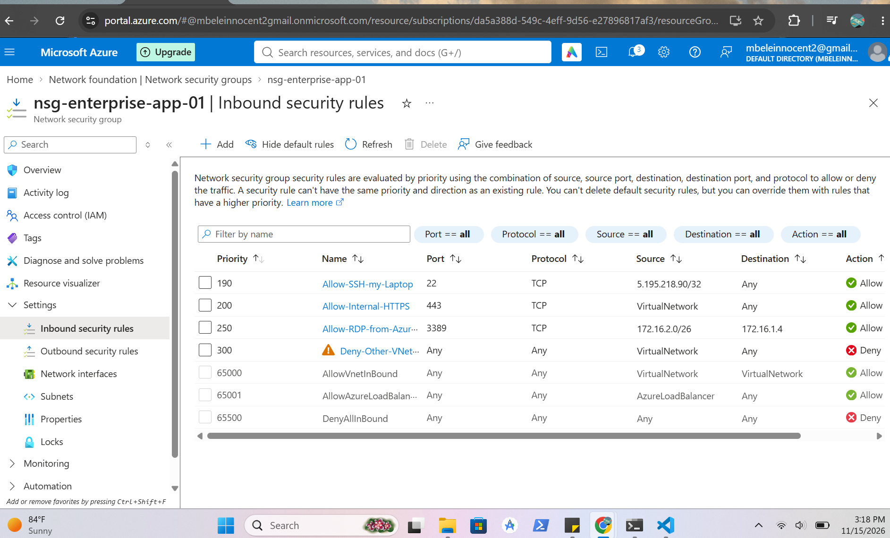