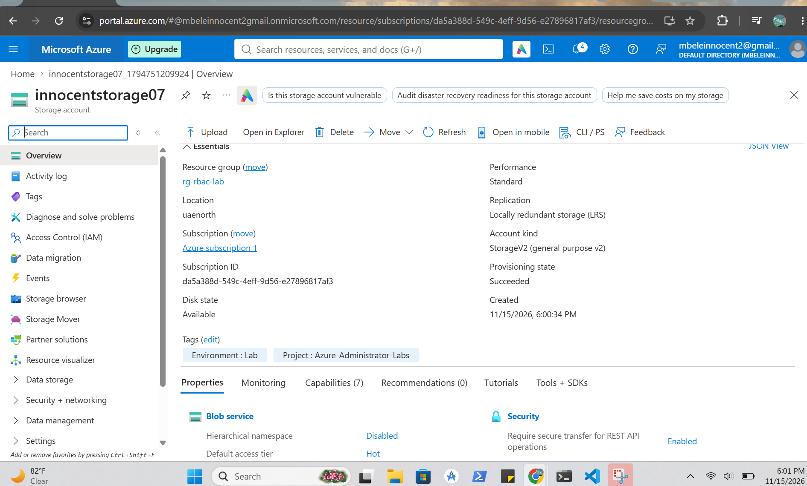
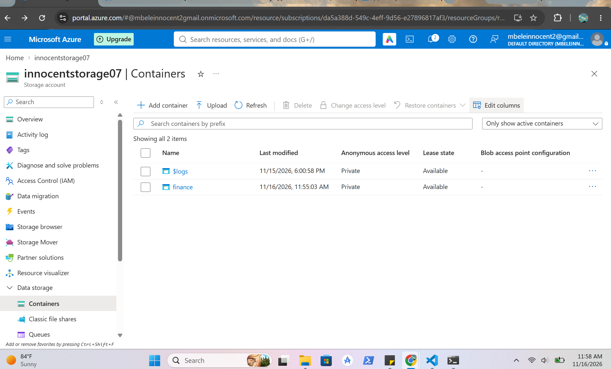
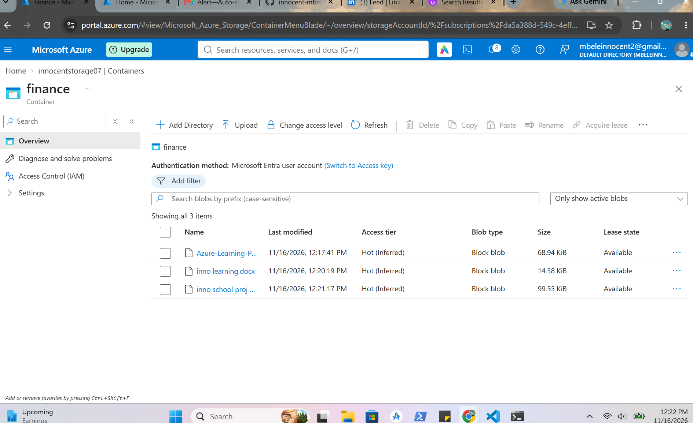
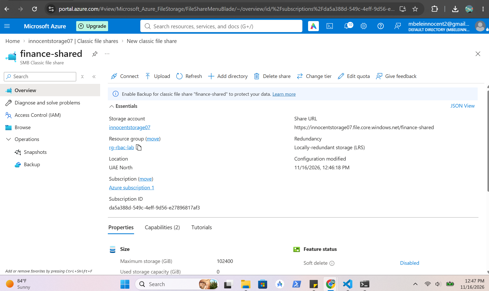
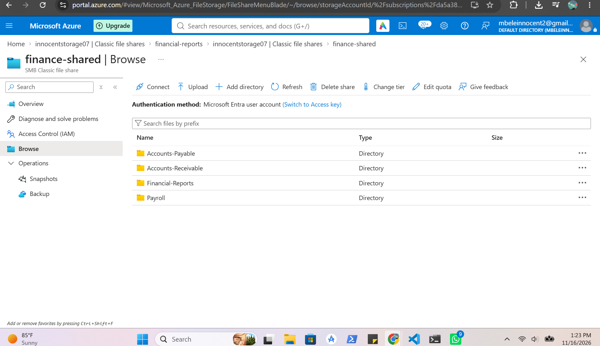

# Implement and Manage Azure Storage

Deployed an Azure StorageV2 account named innocentstorage07 in UAE North using Standard performance and locally redundant storage (LRS). I then created a finance blob container and uploaded sample documents then configured Azure Files with a finance-shared file share and departmental directories for Accounts Payable, Accounts Receivable, Financial Reports and Payroll. I configured access through Azure RBAC and verified file-share access using both the Azure Portal and Windows SMB connectivity. Also enabled blob soft delete, container soft delete and blob versioning and used Azure Monitor to inspect storage transactions and availability.

---

## Screenshots

### Azure Storage Account Deployment

Shows the deployed `innocentstorage07` storage account and its configuration.

### Finance Blob Container

Shows the finance blob container created in the storage account.

### Finance Blob Uploads

Shows the sample documents uploaded to the finance blob container.

### Finance Azure File Share Deployment

Shows the deployed `finance-shared` Azure file share and its configuration.

### Finance Departmental Directories

Shows the departmental directories created within the finance file share: Accounts-Payable, Accounts-Receivable, Financial-Reports and Payroll.

