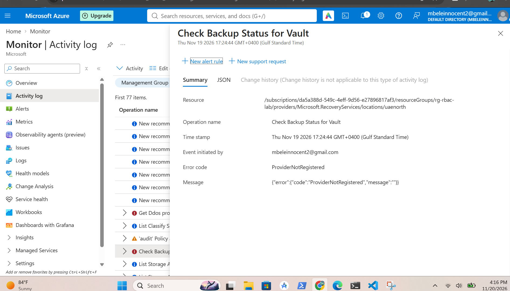
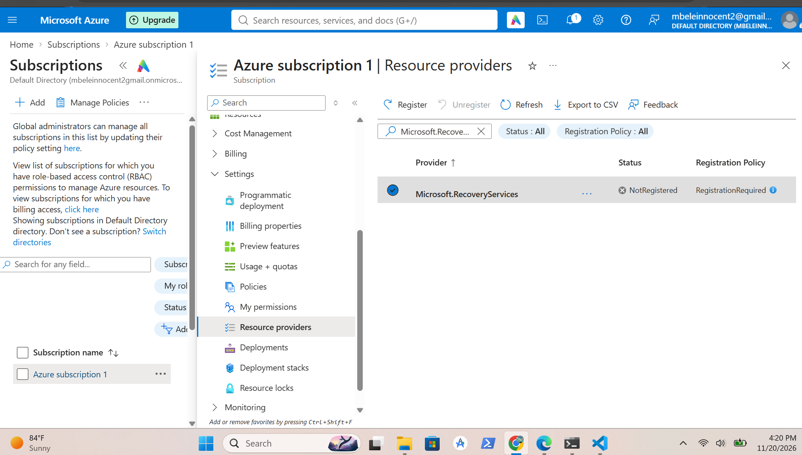
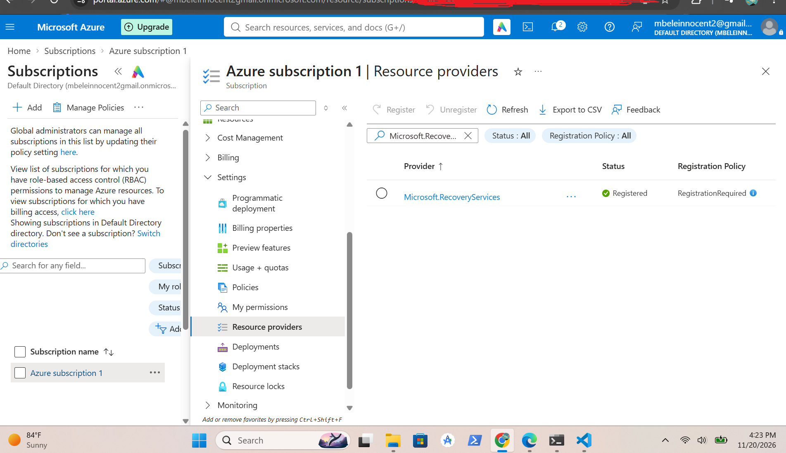
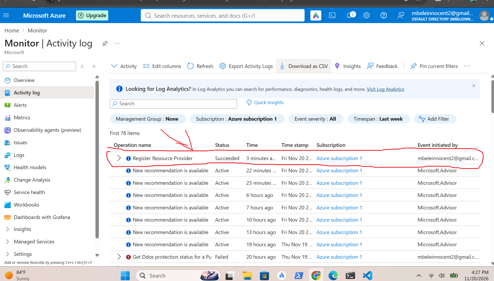
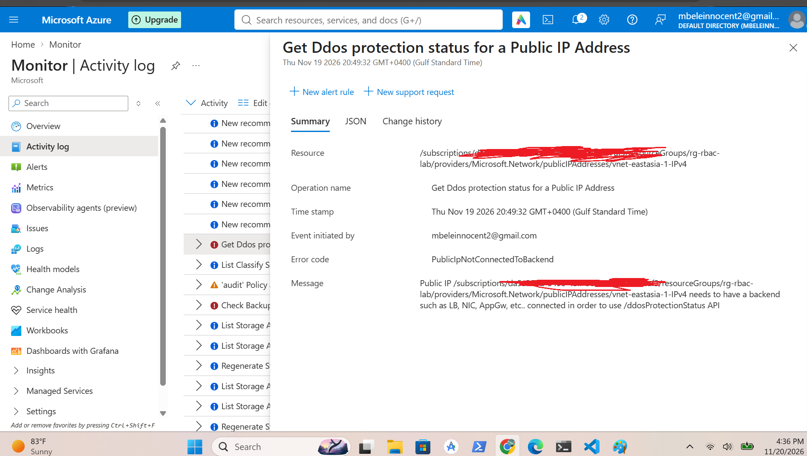
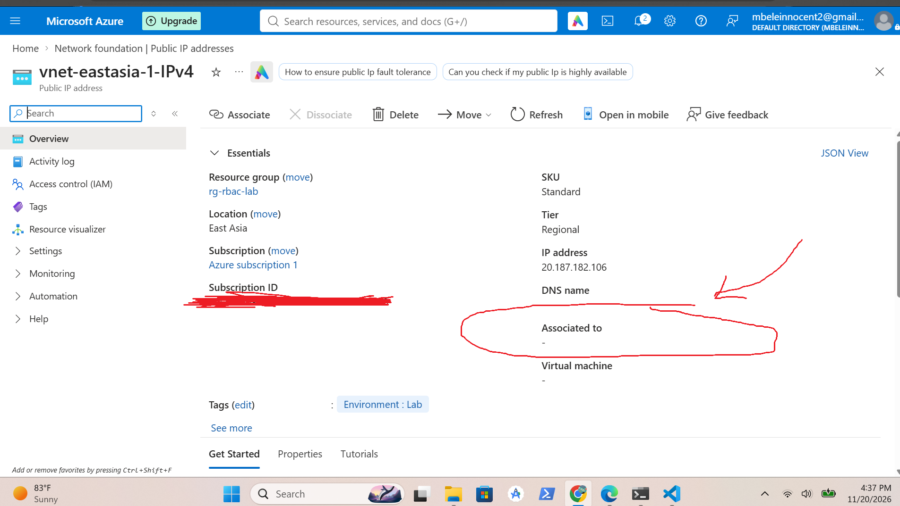

# Monitor and Maintain Azure

Investigated Azure monitoring and maintenance capabilities using Azure Monitor. Reviewed subscription level Activity Log events, filtered historical operations and investigated failed Azure operations. Identified an unregistered Microsoft.RecoveryServices resource provider and corrected the issue by registering the provider at subscription level. Verified the successful registration through the Resource Providers page and Activity Log. I also investigated a failed DDoS protection status operation, identified an unassociated Public IP resource and explored Azure Monitor Metrics using an existing virtual machine.

---

## Screenshots

### Azure Activity Log Investigation

Shows subscription-level Activity Log records filtered to the last seven days, including successful and failed Azure operations.

### Recovery Services Provider Registration Status

Shows Microsoft.RecoveryServices in the NotRegistered state under Azure subscription 1, identifying the cause of the failed backup-status operation.

### Recovery Services Provider Registration

Shows the successful registration of Microsoft.RecoveryServices at subscription level.

### Provider Registration Activity Log Verification

Shows the successful Register Resource Provider operation recorded in Azure Activity Log after the corrective action.

### DDoS Public IP Error Investigation

Shows the investigation of a failed DDoS protection status operation and the PublicIpNotConnectedToBackend error reported by Azure

### Unassociated Public IP Resource

Shows the configuration of the vnet-eastasia-1-IPv4 Public IP address, including its Standard SKU, East Asia region and lack of an associated backend resource.

