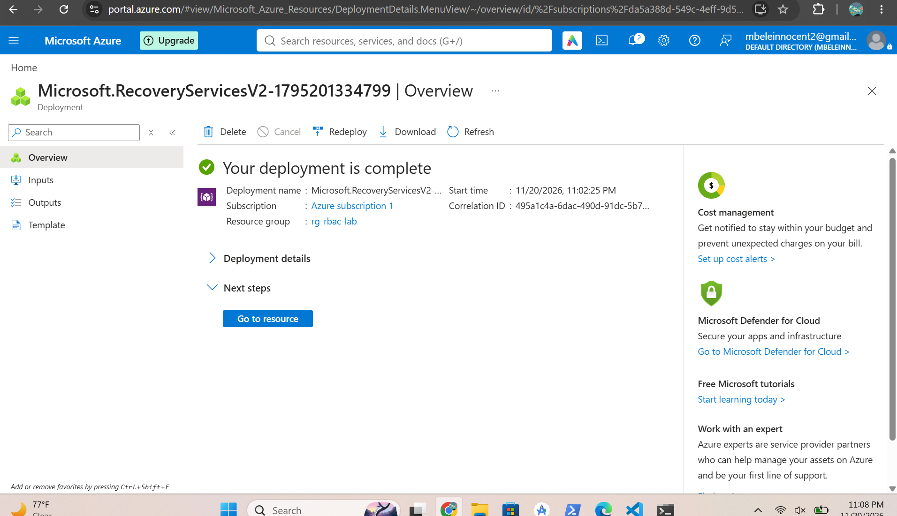
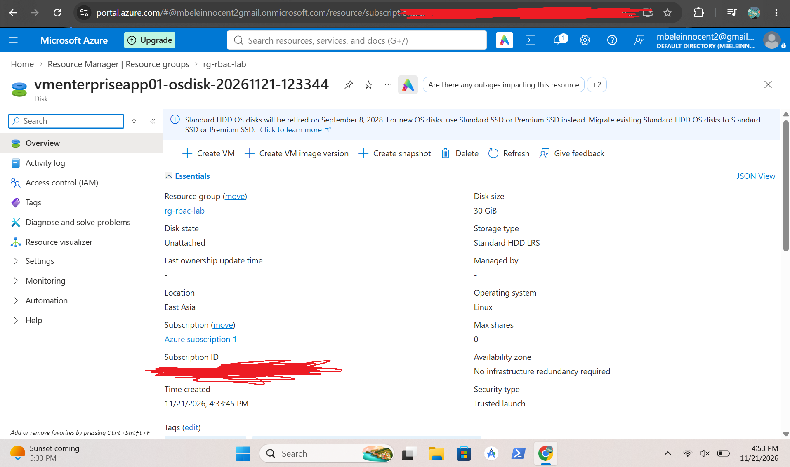

# Azure Backup and Site Recovery

Configured Azure Backup for an existing Linux virtual machine using an Azure Recovery Services vault. Created the vault rsv-azure-backup-01 in East Asia, configured an Enhanced backup policy for the Trusted Launch virtual machine vm-enterprise-app-01 and completed the initial backup. Verified successful backup jobs and available recovery points. Recovered disk using the dedicated Standard StorageV2 staging account with LRS redundancy. Managed to recover and verify a separate 30 GiB Linux OS managed disk in East Asia. 
---

## Screenshots

### Recovery Services Vault Overview

Shows the Recovery Services vault `rsv-azure-backup-01` deployed successfully in East Asia.

### Azure VM Backup Job Status

Shows the backup job history for `vm-enterprise-app-01`, including successful backup operations and earlier failed and cancelled attempts.

### Restored OS Managed Disk

Shows the separately recovered Linux OS disk `vmenterpriseapp01-osdisk-20261121-123344`, with its 30 GiB capacity, East Asia location and unattached state.

